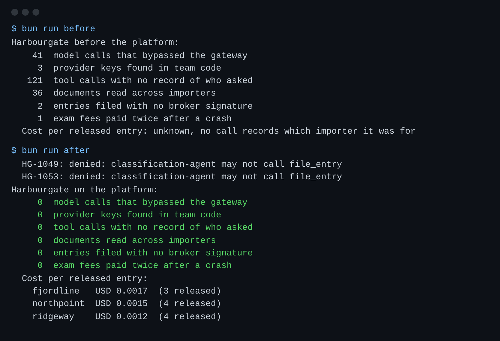

# Start here

You will set up the repo, meet Harbourgate Brokerage, run the finished platform, and see the goal.
No model key is needed: the models answer from recorded replies (replay mode).

## Set up

You need [Bun](https://bun.sh) 1.4.4 or newer and git. Nothing else: no Docker, no cloud account.

```bash
bun install
bun run models
```

Expect: three `PASS` lines, one for each role (`fast`, `smart`, `judge`), on provider `replay`.

To use a real provider later, copy `.env.example` to `.env`, set `LLM_PROVIDER` and that provider's key,
and run `bun run models` again. The checks never need a key.

## Meet the world

Harbourgate Brokerage is a licensed customs broker at the Port of Saltmere. It files customs entries for
three importers: Fjordline Outdoor (jackets, tents, sleeping bags), Ridgeway Roasters (green coffee) and
Northpoint Medical Supply (gloves, thermometers). Three internal teams each run an agent:

| Team           | Its agent                                               | What it may do                            |
| -------------- | ------------------------------------------------------- | ----------------------------------------- |
| Classification | Proposes a tariff code for each invoice line            | Read tariff data and propose. Never file. |
| Paperwork      | Drafts the entry, asks for missing papers, files        | File only lines a licensed broker signed  |
| Holds          | Books the customs exam, pays the fee, waits for release | Pay each fee once                         |

The one legal rule in this world: a licensed broker signs every tariff code before an entry is filed.

```bash
bun run world reset
bun run world
```

Expect: `World reset: 60 shipments, 12 open`, then the importers, the teams and the 12 open shipments.

## Run the system as it is, then the finished platform

```bash
bun run before
bun run after
```

Expect: the "before" card shows `41` model calls that bypassed the gateway and `2` entries filed with no broker signature; the "after" card shows `0` on every line and a cost per released entry for each importer.



## See the goal

By the end of the course, `bun run before` pointed at your own platform prints the "after" card. Each
part builds one layer and its check proves it. Your first step is to record the current numbers:
[meet-the-brokerage](../parts/00-meet-the-brokerage/01-meet-the-brokerage/problem/README.md).

```bash
bun run verify meet-the-brokerage
```

Expect: `FAIL` lines, each with a `Try next:` line. Every step starts failing; that is the starting point.

When a command prints something you do not expect, look it up in [troubleshooting.md](troubleshooting.md).
