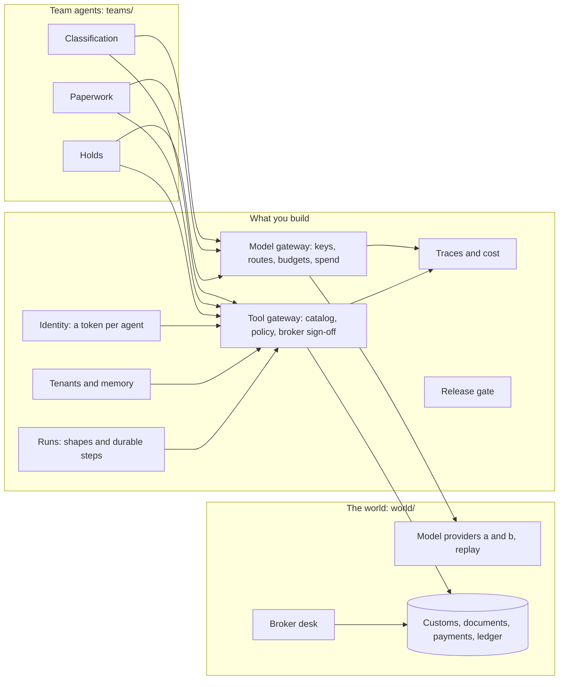

# Build the Agent Platform

Build the one platform every team's agent runs on: one model gateway, one tool policy, one identity per
agent, tenants that never see each other, runs that survive a crash, a cost line per customer and a gate
that blocks a bad release. Then swap a layer and prove nothing broke.

**Who it is for.** Staff engineers, platform teams and architects who must turn one team's agent script into
something every team can use safely. You can write TypeScript and call an HTTP API. You do not need to have
written a policy, a row-level security rule or a durable workflow before.

**What you leave with.** A platform that passes `bun run verify --all`, a report card that goes from
"41 model calls outside any gateway, 2 entries filed with no broker signature, 1 fee paid twice" to all
zeros, and a review that maps each layer to the managed products you might buy instead.

## Run the finished system

No model key, no Docker, no cloud account. Bun 1.4.4 or newer is all you need.

```bash
bun install
bun run world
```

Expect: three importers, three teams, `12 shipments open` and the rule `a licensed broker signs every classification`.

```bash
bun run before
```

Expect: `41  model calls that bypassed the gateway`, `2  entries filed with no broker signature` and `1  exam fees paid twice after a crash`.

```bash
bun run after
```

Expect: `0` on all six lines and a `Cost per released entry` for `fjordline`, `northpoint` and `ridgeway`.


`bun run before` runs the three team scripts as they are now. `bun run after` runs the same open queue on
the finished platform in `reference/`. Both read the system of record, never what an agent claims.

## The world and what you build

**Harbourgate Brokerage** is a licensed customs broker at the Port of Saltmere. It files customs entries for
three importers (the tenants): Fjordline Outdoor, Ridgeway Roasters and Northpoint Medical Supply. Three
internal teams each run an agent: Classification proposes tariff codes, Paperwork drafts and files entries,
and Holds books customs exams and pays their fees. A licensed broker must sign every tariff code before
an entry is filed. Every company in this world is made up.



## Parts

| Part | Minutes | What you build |
|---|---|---|
| [Meet the brokerage](parts/00-meet-the-brokerage/README.md) | 20 | The current report card, recorded in `platform.toml` |
| [Route model calls](parts/01-route-model-calls/README.md) | 55 | A model gateway: team keys, fallback, budgets per importer |
| [Police tool calls](parts-planned/02-police-tool-calls/README.md) | 50 | A tool gateway with a catalog, Cedar policy and broker sign-off |
| [Identify each agent](parts-planned/03-identify-each-agent/README.md) | 35 | A token per agent, exchanged per call |
| [Separate importer data](parts-planned/04-separate-importer-data/README.md) | 35 | Forced row-level security and memory scoped per importer |
| [Choose run shapes](parts-planned/05-choose-run-shapes/README.md) | 20 | One run API for workflows and agent loops |
| [Survive a crash](parts-planned/06-survive-a-crash/README.md) | 40 | Durable steps and idempotent payments |
| [Trace and cost runs](parts-planned/07-trace-and-cost-runs/README.md) | 35 | Spans per run and a cost per released entry per importer |
| [Gate each release](parts-planned/08-gate-each-release/README.md) | 25 | A release gate with never-do metrics |
| [Swap and review](parts-planned/09-swap-and-review/README.md) | 45 | One layer swapped for a product, and the platform review |

Start in [00-orientation](00-orientation/README.md). Every step ends in one command, `bun run verify <step-name>`,
which starts your service, drives it, and reads the world to judge it. `schedules.toml` maps the parts onto
a one-day workshop, four evenings, or five sessions. Parts in `parts-planned/` are outlined and not built yet;
[PARTS.md](PARTS.md) lists them.

## Models

Code asks for a role (`fast`, `smart`, `judge`); only `config/models.ts` names models. `LLM_PROVIDER=replay` is
the default: two local fake providers answer from recorded replies, so the course, its checks and CI need no
key. To go live, copy `.env.example` to `.env`, set `LLM_PROVIDER` to `anthropic`, `openrouter`, `openai` or
`ollama` and add that key.

```bash
bun run models
```

Expect: `PASS  provider replay  role fast`, then the same for `smart` and `judge`.

## The project

Your fork of this repo, with your own build of every layer, run against the Harbourgate world:

1. `bun run verify --report` shows every step passing, in CI on a fresh clone.
2. The report card from `bun run before` against your platform, all zeros.
3. A short recording of the crash test: the Holds worker dies after paying, the run resumes, one payment.
4. `review/platform.md`: one row per layer with its contract, the check that proves it, and the AWS, Google and Microsoft product that would fill it, with the gaps.
5. `decisions/swap.md`: the layer you swapped, for what, and what you gained and lost.

## Read before you start

1. [Building effective agents](https://www.anthropic.com/engineering/building-effective-agents), Anthropic. The words "workflow" and "agent" this course uses.
2. [The lethal trifecta for AI agents](https://simonwillison.net/2025/Jun/16/the-lethal-trifecta/), Simon Willison. Why policy sits at the tool gateway, not in the prompt.
3. [How Grab builds and runs AI agents at scale](https://engineering.grab.com/how-grab-builds-and-runs-ai-agents-at-scale), Grab Engineering. What a shared agent platform holds at a company with many teams.

## Boundary

This course owns the layers that sit between one agent and production, shared by many teams and many
tenants: the model gateway, tool policy, agent identity, tenancy and memory, orchestration, durable runs,
and the trace, cost and release contracts every team must meet.

| Course | It owns | It leaves to this course |
|---|---|---|
| [agentic-ai-buildcamp](https://github.com/learnwithparam/agentic-ai-buildcamp) | One AI employee, from design to operating it | The shared platform many employees run on |
| [agentic-system-design](https://github.com/learnwithparam/agentic-system-design) | Design docs and ADRs, decided on paper, no code | Building and checking each layer in code |
| [agentic-deployment](https://github.com/learnwithparam/agentic-deployment) | Containers, secrets, canary releases and rollback | What runs inside those containers: gateway, policy, identity, tenancy, runs |
| [agentic-cli-workshop](https://github.com/learnwithparam/agentic-cli-workshop) | The agent loop inside a coding CLI | The services an agent calls out to |

The rules every course repo follows, and the check behind each, are in [STANDARD.md](STANDARD.md).
