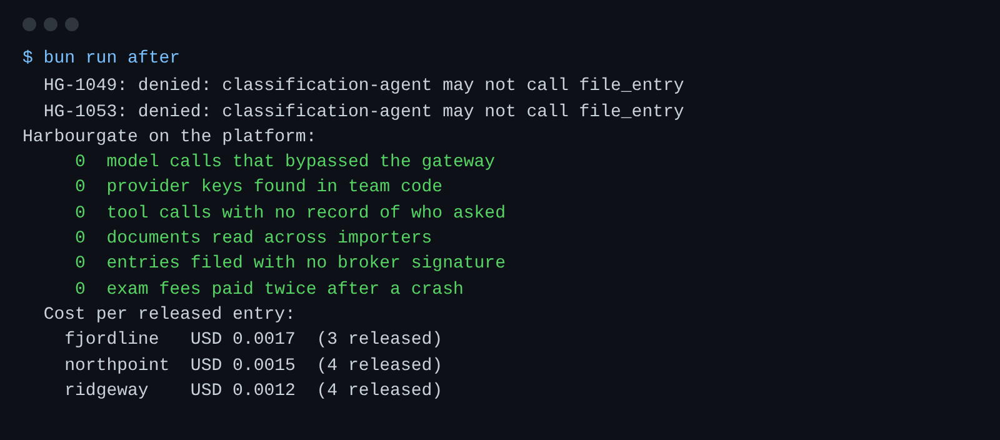
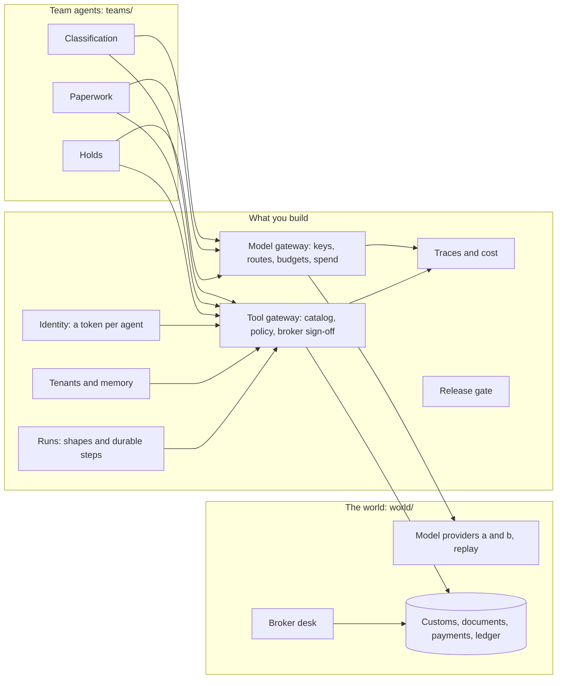

# Build the Agent Platform

In this course you build one platform that every team's AI agent runs on.
An agent is a program that asks an AI model what to do next, then does it.
Your platform gives every agent the same safe road to production.

It has seven layers:

- one model gateway, the single door for every call to an AI model;
- one tool policy, the rules for what each agent may do;
- one identity for each agent;
- customers whose data never mixes;
- runs that survive a crash;
- a cost line for each customer;
- a gate that stops a bad release.

At the end, you swap one layer for a product and prove that nothing broke.

**Who it is for.** You are a staff engineer, on a platform team, or an architect.
One team has an agent script, and you must make it safe for every team to use.
You can write TypeScript and call an HTTP API.
You do not need to know about policies, row-level security or durable workflows yet.
The course explains each one when you meet it.

**What you leave with.** You leave with three things:

- a platform that passes `bun run verify --all`;
- a report card that goes from bad numbers to all zeros;
- a review that compares each layer to products you could buy instead.

For example, the report card starts at "41 model calls outside any gateway".
It also shows "2 entries filed with no broker signature" and "1 fee paid twice".
When you finish, every one of those numbers is 0.

## Run the finished system

You need Bun 1.4.4 or newer, and nothing else.
You do not need a model key, Docker or a cloud account.

```bash
bun install
bun run world
```

Expect: three importers, three teams, `12 shipments open` and the rule `a licensed broker signs every classification`.

```bash
bun run before
```

Expect: `41  model calls that bypassed the gateway`, `2  entries filed with no broker signature` and `1  exam fees paid twice after a crash`.

```bash
bun run after
```

Expect: `0` on all six lines and a `Cost per released entry` for `fjordline`, `northpoint` and `ridgeway`.

Above the card you also see two lines like `HG-1049: denied: classification-agent may not call file_entry`.
That is not an error. The platform refuses the Classification agent when it tries to file an entry by itself.



`bun run before` runs the three team scripts as they work today.
`bun run after` runs the same open shipments on the finished platform in `reference/`.
Both commands count from the system of record, the database that holds the truth.
They never trust what an agent says about itself.

## The world and what you build

**Harbourgate Brokerage** is a customs broker at the Port of Saltmere.
A customs broker fills in the forms that let goods into a country.
Each form is called a customs entry.

Harbourgate works for three importers: Fjordline Outdoor, Ridgeway Roasters and Northpoint Medical Supply.
The importers are the platform's tenants: customers who share it but must never see each other's data.

Three teams inside Harbourgate each run an agent:

- **Classification** proposes a tariff code for each item. A tariff code says what the goods are, so customs knows the tax.
- **Paperwork** drafts the customs entry and files it.
- **Holds** books a customs exam when customs stops a container, and pays the exam fee.

A licensed broker must sign every tariff code before an entry is filed.
For example, Ridgeway's green coffee beans need a code, a broker's signature, and then an entry.
Every company in this world is made up.



## Parts

| Part                                                                | Minutes | What you build                                                   |
| ------------------------------------------------------------------- | ------- | ---------------------------------------------------------------- |
| [Meet the brokerage](parts/00-meet-the-brokerage/README.md)         | 20      | The current report card, recorded in `platform.toml`             |
| [Route model calls](parts/01-route-model-calls/README.md)           | 55      | A model gateway: team keys, fallback, budgets per importer       |
| [Police tool calls](parts/02-police-tool-calls/README.md)           | 50      | A tool gateway with a catalog, a policy file and broker sign-off |
| [Identify each agent](parts/03-identify-each-agent/README.md)       | 35      | A token per agent, exchanged per call                            |
| [Separate importer data](parts/04-separate-importer-data/README.md) | 35      | Forced row-level security and memory scoped per importer         |
| [Choose run shapes](parts/05-choose-run-shapes/README.md)           | 20      | One run API for workflows and agent loops                        |
| [Survive a crash](parts/06-survive-a-crash/README.md)               | 40      | Durable steps and idempotent payments                            |
| [Trace and cost runs](parts/07-trace-and-cost-runs/README.md)       | 35      | Spans per run and a cost per released entry per importer         |
| [Gate each release](parts/08-gate-each-release/README.md)           | 25      | A release gate with never-do metrics                             |
| [Swap and review](parts/09-swap-and-review/README.md)               | 45      | One layer swapped for a product, and the platform review         |

Start in [00-orientation](00-orientation/README.md).
Every step ends with one command: `bun run verify <step-name>`.
It starts your service, sends it work, and reads the world to judge the result.
`schedules.toml` fits the parts into a one-day workshop, four evenings, or five sessions.
All ten parts are built, and each one has a check.
[PARTS.md](PARTS.md) lists what each part teaches.

## Models

Code never names a model. It asks for a role instead: `fast`, `smart` or `judge`.
Only `config/models.ts` says which model plays each role.

The default is `LLM_PROVIDER=replay`.
In replay mode, two fake providers on your machine answer from recorded replies.
So the course, its checks and CI need no key and cost nothing.

To use a real model, copy `.env.example` to `.env`.
Then set `LLM_PROVIDER` to `anthropic`, `openrouter`, `openai` or `ollama`, and add that provider's key.

```bash
bun run models
```

Expect: `PASS  provider replay  role fast`, then the same for `smart` and `judge`.

## The project

Your project is your fork of this repo, with your own build of every layer.
You hand in five things:

1. `bun run verify --report` shows every step passing, in CI, on a fresh clone.
2. The report card from `bun run before` against your platform, with all zeros.
3. A short recording of the crash test. The Holds worker dies after it pays. The run starts again, and there is still only one payment.
4. `review/platform.md`, with one row per layer. Each row has the layer's contract and the check that proves it. It also names the AWS, Google and Microsoft product that could do the job, and what that product misses.
5. `decisions/swap.md`: which layer you swapped, what you swapped it for, and what you gained and lost.

## Read before you start

1. [Building effective agents](https://www.anthropic.com/engineering/building-effective-agents), Anthropic. It explains the words "workflow" and "agent" as this course uses them.
2. [The lethal trifecta for AI agents](https://simonwillison.net/2025/Jun/16/the-lethal-trifecta/), Simon Willison. It shows why the rules live in the tool gateway, not in the prompt.
3. [How Grab builds and runs AI agents at scale](https://engineering.grab.com/how-grab-builds-and-runs-ai-agents-at-scale), Grab Engineering. It shows what a shared agent platform holds at a company with many teams.

## Boundary

This course covers the layers between one agent and production.
Many teams and many tenants share these layers.
They are the model gateway, the tool policy, agent identity, tenants and memory, how runs are shaped, and runs that survive a crash.
They also include the trace, cost and release rules that every team must meet.

| Course                                                                           | It owns                                           | It leaves to this course                                                    |
| -------------------------------------------------------------------------------- | ------------------------------------------------- | --------------------------------------------------------------------------- |
| [agentic-ai-buildcamp](https://github.com/learnwithparam/agentic-ai-buildcamp)   | One AI employee, from design to operating it      | The shared platform many employees run on                                   |
| [agentic-system-design](https://github.com/learnwithparam/agentic-system-design) | Design docs and ADRs, decided on paper, no code   | Building and checking each layer in code                                    |
| [agentic-deployment](https://github.com/learnwithparam/agentic-deployment)       | Containers, secrets, canary releases and rollback | What runs inside those containers: gateway, policy, identity, tenancy, runs |
| [agentic-cli-workshop](https://github.com/learnwithparam/agentic-cli-workshop)   | The agent loop inside a coding CLI                | The services an agent calls out to                                          |

[STANDARD.md](STANDARD.md) lists the rules every course repo follows, and the check behind each rule.
