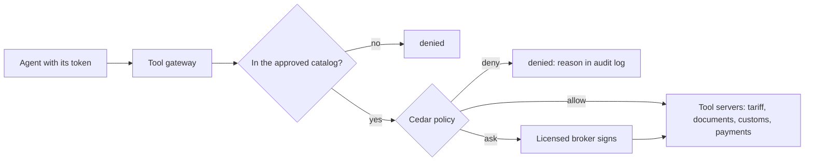

# Police tool calls

## The problem

121 tool calls left no record of who asked.
The Classification agent even filed two rush entries itself.
That breaks the one legal rule in this world: a licensed broker signs every tariff code before filing.

Rules written in a prompt do not hold.
So the platform must decide which agent may call which tool, outside the model.
For example, the Classification agent asks to call `file_entry`.
The tool gateway answers `denied: classification-agent may not call file_entry`.

## Why it matters

DoorDash runs one gateway that every agent uses to find and call tools.
So access and secrets live in one place ([DoorDash Engineering](https://careersatdoordash.com/blog/how-doordash-built-a-centralized-gateway-for-ai-agent-tool-access/)).
Uber runs a gateway for MCP servers, the servers that offer tools to agents.
It keeps a list of the servers, and a new tool starts switched off ([Uber Engineering](https://www.uber.com/us/en/blog/designing-mcp-gateway/)).



| Step                      | Minutes | What you produce                                                                                       | What its check reads                                                                                                                                                |
| ------------------------- | ------- | ------------------------------------------------------------------------------------------------------ | ------------------------------------------------------------------------------------------------------------------------------------------------------------------- |
| `register-approved-tools` | 15      | `tools.yaml`: the approved MCP servers with pinned tool hashes; the gateway lists only those           | `tools/list` through the gateway; a planted tool update whose hash differs; a direct call to an unlisted server                                                     |
| `deny-the-planted-call`   | 20      | Cedar policies for which agent may call which tool, for which importer                                 | Every cell of `checks/policy-table.csv` against the gateway's decision; the audit log line for the planted `file_entry`; fail closed when the policy engine is down |
| `require-broker-signoff`  | 15      | An "ask" result for filing: the run waits until a licensed broker from `world/data/brokers.json` signs | customs-sim filings with an unsigned line (must be 0); a signature from the trainee is refused                                                                      |

## Walkthrough

TODO(part session): the steps do not exist yet. These are the commands this part will use.

```bash
bun run verify register-approved-tools
bun run verify deny-the-planted-call
bun run verify require-broker-signoff
bun run verify part police-tool-calls
```

Expect: TODO(part session)
