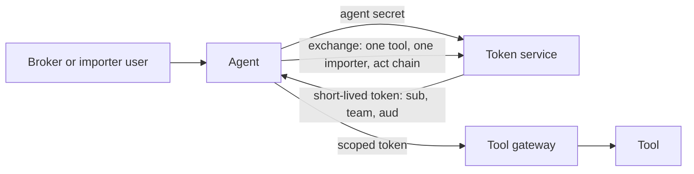

# Identify each agent

## The problem

All three agents act under one shared identity, so the audit log says "agent" and nothing more. When the Holds agent pays a fee for Northpoint, nobody can prove which agent did it, for which importer, on whose behalf.

## Why it matters

Uber describes giving each agent its own workload identity and short-lived tokens that carry the chain of who acted for whom ([Uber Engineering](https://www.uber.com/blog/solving-the-agent-identity-crisis/)).



| Step | Minutes | What you produce | What its check reads |
|---|---|---|---|
| `issue-agent-identities` | 15 | A token service that issues each registered agent a signed, short-lived token with `sub`, `team` and `aud` | 401 for an expired token and for the wrong audience at the tool gateway; the agent's name on every audit row |
| `exchange-tokens-per-call` | 20 | Token exchange (RFC 8693 shape): one tool, one importer, on behalf of one broker (`act`) | 403 when the Holds agent uses a Northpoint token on a Fjordline container; the token the fake upstream tool received is never the agent's own |

## Walkthrough

TODO(part session): the steps do not exist yet. These are the commands this part will use.

```bash
bun run verify issue-agent-identities
bun run verify exchange-tokens-per-call
bun run verify part identify-each-agent
```

Expect: TODO(part session)
