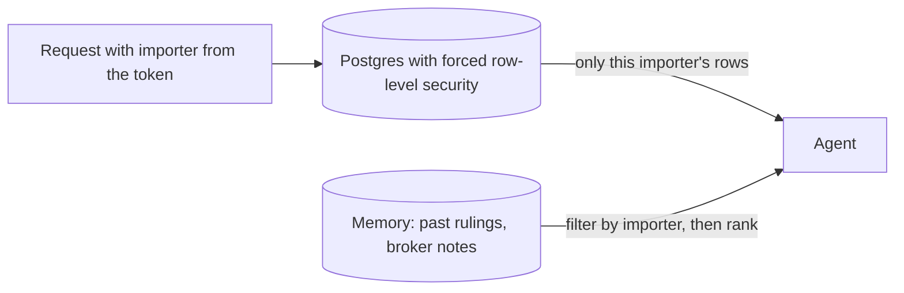

# Separate importer data

## The problem

The Paperwork agent read 36 documents that belong to other importers.
Its search did not care which importer the work was for.
For example, while it drafted an entry for Ridgeway, it could read Fjordline's invoices and prices.
A broker must keep each client's papers private, so this breaks the broker's duty.

## Why it matters

AWS writes about agents that serve many customers on Bedrock AgentCore.
Keeping each customer's data apart is still the builder's job ([AWS Machine Learning Blog](https://aws.amazon.com/blogs/machine-learning/building-multi-tenant-agents-with-amazon-bedrock-agentcore/)).



| Step                        | Minutes | What you produce                                                                                            | What its check reads                                                                                                                                            |
| --------------------------- | ------- | ----------------------------------------------------------------------------------------------------------- | --------------------------------------------------------------------------------------------------------------------------------------------------------------- |
| `isolate-importer-data`     | 20      | Forced row-level security on every table with importer data; the importer set per connection from the token | Queries as each importer on every table (0 foreign rows); `relforcerowsecurity` on every table with an `importer_id`; the cross-importer reads count drops to 0 |
| `scope-memory-per-importer` | 15      | Agent memory filtered by importer before ranking; superseded rulings are never candidates                   | Recall for Ridgeway with a planted near-identical Fjordline note; a superseded ruling never returns; memory written in one run is found in the next             |

## Walkthrough

TODO(part session): the steps do not exist yet. These are the commands this part will use.

```bash
bun run verify isolate-importer-data
bun run verify scope-memory-per-importer
bun run verify part separate-importer-data
```

Expect: TODO(part session)
