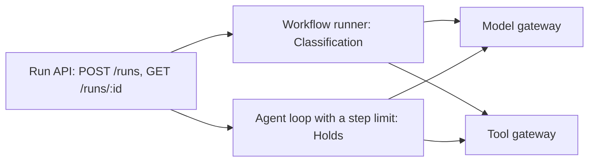

# Choose run shapes

## The problem

Classification follows a fixed path. Holds needs an agent that decides its next step.
Each team built its own runner, the code that starts a run and moves it along.
Nothing is shared: not identity, not budgets, not the record of a run.
For example, a Holds run and a Classification run for the same shipment leave no common record.

## Why it matters

Allianz runs Project Nemo, where several agents handle insurance claims together.
A planner agent leads them, and people handle the claims that will likely be refused ([Allianz](https://www.allianz.com/en/mediacenter/news/articles/251103-when-the-storm-clears-so-should-the-claim-queue.html)).



| Step              | Minutes | What you produce                                                                                          | What its check reads                                                                                                                                                                            |
| ----------------- | ------- | --------------------------------------------------------------------------------------------------------- | ----------------------------------------------------------------------------------------------------------------------------------------------------------------------------------------------- |
| `run-both-shapes` | 20      | A run API that starts either a workflow or an agent loop with a step limit, plus `decisions/run-shape.md` | Both shapes complete on 3 shipments; a loop that hits its limit ends `stopped_at_limit`; every call in a run carries the same `run_id` in the spend log and audit; the decision file's sections |

## Walkthrough

TODO(part session): the steps do not exist yet. These are the commands this part will use.

```bash
bun run verify run-both-shapes
bun run verify part choose-run-shapes
```

Expect: TODO(part session)
