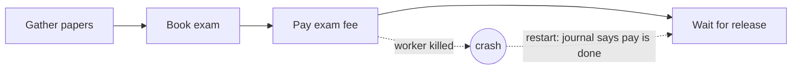

# Survive a crash

## The problem

The Holds worker died right after paying an exam fee. On restart it started from the top and paid again, and the container waited longer at the terminal.

## Why it matters

Instacart describes Maple, its service for large batches of model calls, which runs on Temporal for retries and recovery ([Instacart](https://company.instacart.com/tech-innovation/simplifying-large-scale-llm-processing-across-instacart-with-maple)).



| Step | Minutes | What you produce | What its check reads |
|---|---|---|---|
| `resume-a-killed-run` | 25 | The Holds run as journaled durable steps | The check kills the worker after `pay_exam_fee` (guard: a worker really died); the payments table shows exactly 1 payment; model calls equal decision steps |
| `release-the-container-once` | 15 | An idempotency key on every money-moving or filing tool, and a durable wait for release with a timeout that pages a broker | Two deliveries of one release event cause 1 release; a run past free time logs a demurrage reason; a replay of the whole run moves no money |

## Walkthrough

TODO(part session): the steps do not exist yet. These are the commands this part will use.

```bash
bun run verify resume-a-killed-run
bun run verify release-the-container-once
bun run verify part survive-a-crash
```

Expect: TODO(part session)
