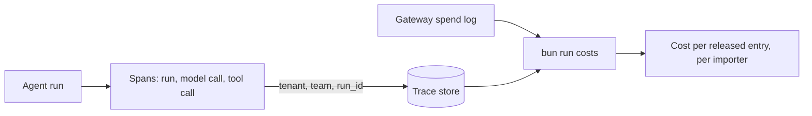

# Trace and cost runs

## The problem

Finance asks what Northpoint cost. The Holds team asks why one entry took so long.
Nobody can answer either question.
No call records the run, the team and the importer together.
For example, `bun run before` prints `Cost per released entry: unknown, no call records which importer it was for`.

## Why it matters

Booking.com runs AgentHub. It gives every team's agent the same tracing, safety rules and tests ([Booking.com](https://booking.ai/introducing-agenthub-booking-com-platform-for-modular-travel-ai-agents-68bc521a0f50)).



| Step                     | Minutes | What you produce                                                                                     | What its check reads                                                                                                                                                          |
| ------------------------ | ------- | ---------------------------------------------------------------------------------------------------- | ----------------------------------------------------------------------------------------------------------------------------------------------------------------------------- |
| `trace-one-entry`        | 20      | Spans for runs, model calls and tool calls with GenAI attributes, with `tenant`, `team` and `run_id` | The trace store for one entry: one trace, `tenant` on every span, token counts on model spans, the policy decision on tool spans, no field from `checks/sensitive-fields.txt` |
| `split-cost-by-importer` | 15      | `bun run costs`: cost per released entry per importer, joining traces to spend rows                  | Cost by importer sums to the providers' bill; 0 spend rows without a tenant; a planted untagged batch job shows as unattributed, then disappears                              |

## Walkthrough

TODO(part session): the steps do not exist yet. These are the commands this part will use.

```bash
bun run verify trace-one-entry
bun run verify split-cost-by-importer
bun run verify part trace-and-cost-runs
```

Expect: TODO(part session)
