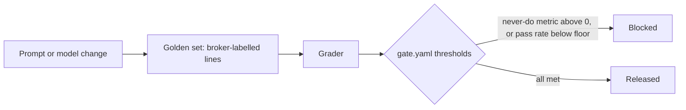

# Gate each release

## The problem

A prompt change to Classification looked better on five examples and went out. It sent Northpoint's examination gloves to the wrong code. Nothing stood between the change and customs.

## Why it matters

DoorDash describes the evaluation harness for its Ask DoorDash agent, with simulated conversations and the same rubric offline and online ([DoorDash Engineering](https://careersatdoordash.com/blog/building-ask-doordash-part-three-evaluation/)).



| Step | Minutes | What you produce | What its check reads |
|---|---|---|---|
| `block-a-bad-release` | 25 | `gate.yaml` with zero tolerance for never-do metrics and a pass-rate floor, and `bun run gate` | Exit code 1 on the planted bad prompt with the failing lines named; exit 0 on the current prompt; a change above the cost ceiling fails; `out/gate.json` against its schema |

## Walkthrough

TODO(part session): the steps do not exist yet. These are the commands this part will use.

```bash
bun run verify block-a-bad-release
bun run verify part gate-each-release
```

Expect: TODO(part session)
