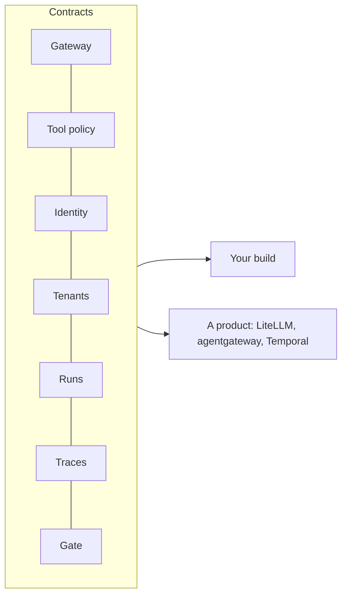

# Swap and review

## The problem

The review board asks what happens if Harbourgate moves to a managed agent platform. The answer has to be "the contracts still pass", and an architect has to show which product fills each layer and where the gaps are.

## Why it matters

Grab describes the shared framework and gateway its teams build agents on ([Grab Engineering](https://engineering.grab.com/how-grab-builds-and-runs-ai-agents-at-scale)).



| Step | Minutes | What you produce | What its check reads |
|---|---|---|---|
| `swap-one-layer` | 25 | One layer replaced by a product, changing only `platform.toml` and adapters, plus `decisions/swap.md` | `bun run verify --all` passes with the new layer; no change under `teams/`; the decision file names what was gained and lost |
| `pass-the-platform-review` | 20 | `review/platform.md`, one row per layer with its contract, its check and the managed product that would fill it, and `bun run onboard` for a fourth team | Every layer has a row naming a passing check; a new Billing agent onboards with one command and passes; `bun run before` against the learner's platform prints all zeros |

## Walkthrough

TODO(part session): the steps do not exist yet. These are the commands this part will use.

```bash
bun run verify swap-one-layer
bun run verify pass-the-platform-review
bun run verify part swap-and-review
```

Expect: TODO(part session)
