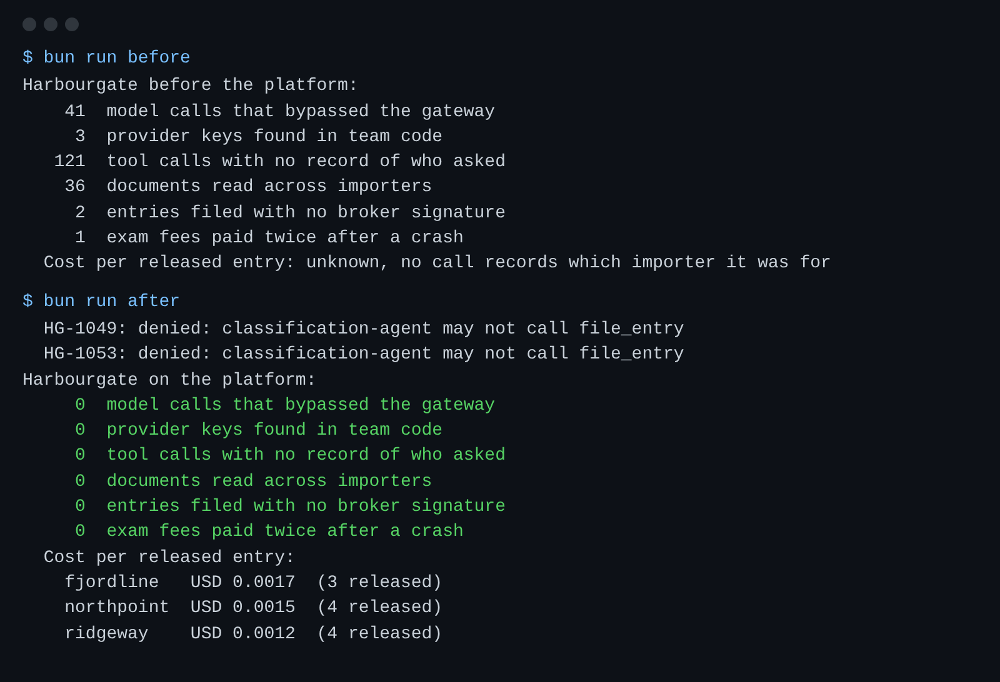

# Meet the brokerage

## The problem

Harbourgate Brokerage clears goods through the Port of Saltmere for three importers.
Three teams each built their own agent, each in their own way.
Nobody can say what the agents did, for which importer, or what it cost.
Before you build anything, you need numbers that show what is wrong today.



## Your challenge

Run the three team scripts as they work today.
Read the report card they print, and copy it into `platform.toml` in this folder.
`platform.toml` is your platform's address book. Later parts add to it.

1. Run `bun run world` and read the importers, the teams and the open queue.
2. Run `bun run before` and read the six numbers.
3. Run `bun run after` to see the same queue on the finished platform.
4. Fill in `platform.toml`: your name, your run mode, and the six numbers from `bun run before`.

For example, `bun run before` prints this line:

```text
    41  model calls that bypassed the gateway
```

So under `[before]` in `platform.toml` you write:

```toml
calls_outside_gateway = 41
```

Do the same for the other five lines.

```bash
bun run verify meet-the-brokerage
```

Expect: `Done. All 10 rules pass.`

## Done when

- The world starts and its open queue has 12 shipments.
- `platform.toml` names you and a run mode: `replay`, `anthropic`, `openrouter`, `openai` or `ollama`.
- Each of the six numbers under `[before]` matches what `bun run before` printed.

## If you get stuck

| What you see                     | Fix                                                                                                                     |
| -------------------------------- | ----------------------------------------------------------------------------------------------------------------------- |
| `FAIL run_mode is one of ...`    | Use `replay` unless you put a key in `.env`.                                                                            |
| `FAIL you recorded how many ...` | Run `bun run before` again and copy the number from that line. The world resets each run, so the numbers do not change. |
| `FAIL the world starts ...`      | Run `bun run world reset` and read [troubleshooting](../../../../00-orientation/troubleshooting.md).                    |

## Words you will use

- **Importer**: a company whose goods Harbourgate clears. Each importer is a tenant of the platform and must never see another's papers.
- **Entry**: the filing that tells customs what is in a container and what duty is owed.
- **Tariff code**: the line in the tariff schedule that a good falls under. A licensed broker must sign every code.
- **Hold**: customs stops a container for an exam. The container waits, and the waiting costs money.
- **Replay mode**: the models answer from recorded replies, so everything runs with no key.
