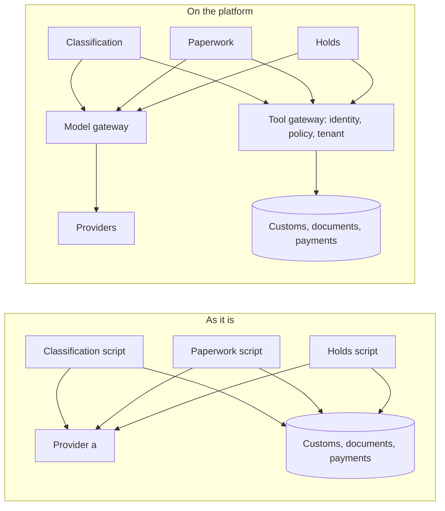

# Meet the brokerage

## The problem

Three teams at Harbourgate Brokerage run three agents, built three ways. Each pastes its own provider
key, calls tools with no identity, and reads any importer's papers. Two entries went to customs with no
broker signature, and one exam fee was paid twice after a crash. This part measures that, so every later
part has a number to drive to zero.



| Step                 | Minutes | What you produce                                                      |
| -------------------- | ------- | --------------------------------------------------------------------- |
| `meet-the-brokerage` | 20      | `platform.toml` with your name, run mode and the six "before" numbers |

## Walkthrough

```bash
bun run world
bun run before
bun run after
bun run verify meet-the-brokerage
```

Expect: the open queue of 12 shipments, the "before" card, the "after" card with six zeros, then `Done. All 10 rules pass.` once `platform.toml` is filled in.
