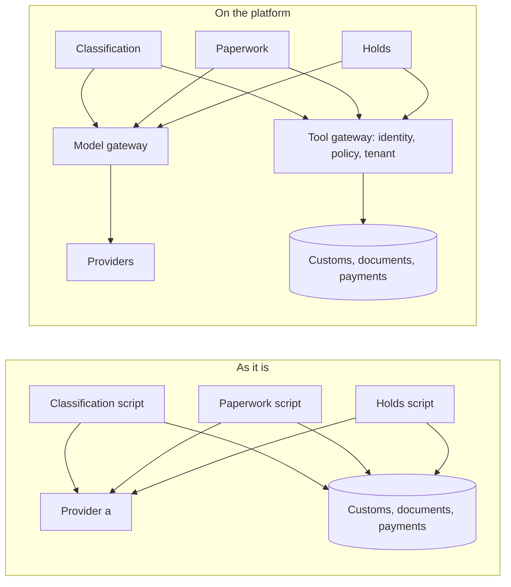

# Meet the brokerage

## The problem

Three teams at Harbourgate Brokerage run three agents, and each team built its agent in its own way.
Each agent pastes in its own provider key.
A provider key is the secret that lets you call an AI model and puts the cost on your bill.
Each agent calls tools without saying who it is, and reads any importer's papers.

The damage is real.
Two entries went to customs with no broker signature.
One exam fee was paid twice after a crash.

This part measures all of that.
Then every later part has a number to bring down to zero.
For example, `bun run before` prints `41  model calls that bypassed the gateway`.
Part 1 builds the gateway that brings that number to 0.



| Step                 | Minutes | What you produce                                                      |
| -------------------- | ------- | --------------------------------------------------------------------- |
| `meet-the-brokerage` | 20      | `platform.toml` with your name, run mode and the six "before" numbers |

## Walkthrough

```bash
bun run world
bun run before
bun run after
bun run verify meet-the-brokerage
```

Expect: the open queue of 12 shipments, the "before" card, the "after" card with six zeros, then `Done. All 10 rules pass.` once `platform.toml` is filled in.

## Finished

You now have today's report card in `platform.toml`, with six numbers that are not zero.
Every later part brings one of those numbers down to 0.

The next part, `route-model-calls`, starts with the first number: 41 model calls that bypassed the gateway.
