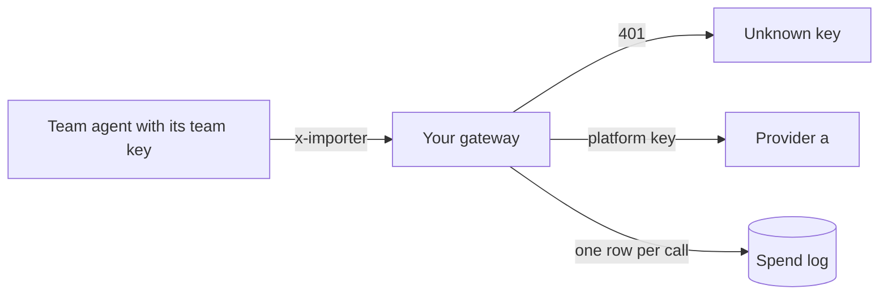
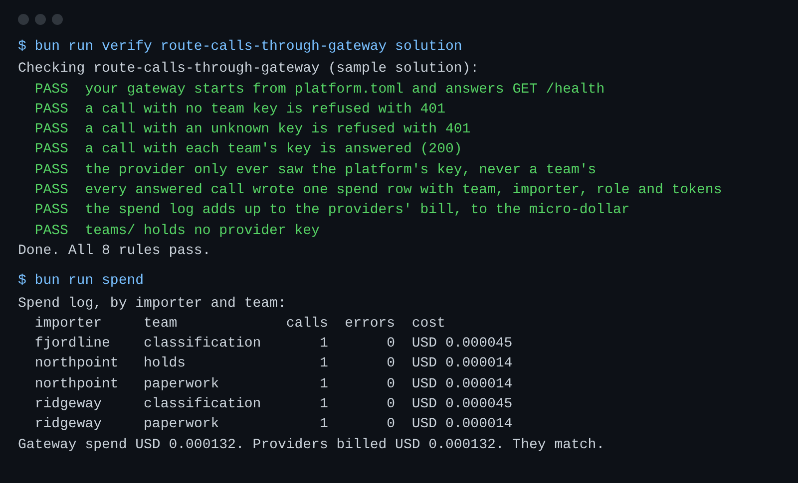

# Route calls through a gateway

## The problem

The report card says 41 model calls went straight to a provider and 3 provider keys sit in team code.
Any team can spend without limit, a leaked key is a leaked bill, and finance cannot split the cost by importer.



## Your challenge

Turn `gateway.ts` from a pass-through into the one door for model calls:

1. Read the caller's `Authorization: Bearer <team key>` and find the team in `TEAMS_FILE`. No team, 401.
2. Call provider a with `PROVIDER_A_KEY`, the platform's key. Never forward the caller's header.
3. Price the call from the usage the provider returned and the prices in `PROVIDERS_FILE`.
4. POST one row to `LEDGER_URL/spend` with `team`, `importer`, `role`, `provider`, `tokens_in`, `tokens_out`, `cost_micros`.
5. Remove the provider key from `teams/paperwork.ts`; send `process.env.TEAM_KEY` instead.

The check starts your gateway with the command in `platform.toml`, so any language works.

```bash
bun run verify route-calls-through-gateway
bun run spend
```

Expect: `Done. All 8 rules pass.`, then a spend table that ends `They match.`



## Done when

- A call with no key, or an unknown key, gets 401.
- A call with each team's key is answered.
- The provider only ever saw the platform's key.
- Every answered call wrote one spend row, and the spend log adds up to the providers' bill to the micro-dollar.
- `teams/` holds no provider key.

## If you get stuck

| What you see | Fix |
|---|---|
| `FAIL a call with each team's key is answered` | The provider got a key it does not know. Send `PROVIDER_A_KEY`. |
| `FAIL the spend log adds up ...` | Use `usage.prompt_tokens` and `usage.completion_tokens` from the reply, times the prices for that role. Do not estimate from text length. |
| `FAIL your gateway starts ...` | Run `PORT=4000 bun gateway.ts` in this folder and read the error. |

## Words you will use

- **Gateway**: one service that every model call passes through, so keys, limits and records live in one place.
- **Virtual key**: a key the platform gives a team. It only works at the gateway and can be revoked without touching a provider.
- **Role**: what a call asks for (`fast`, `smart`, `judge`). The gateway decides which model fills it.
- **Micro-dollar**: one millionth of a US dollar. Whole numbers keep sums exact.
