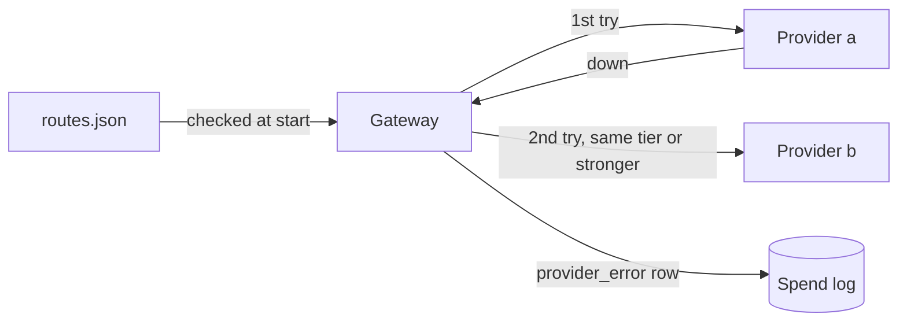

# Fall back on outage

## The problem

When provider a is down, every agent at Harbourgate stops.
No codes are proposed, no entries are drafted, and containers wait at the port.
A fallback fixes that: when one provider fails, the gateway tries the next one.
But a careless fallback quietly answers hard tariff questions with a weaker model.



## Your challenge

`routes.json` lists, for each role, the hops to try in order.
A hop is one provider and role, written `provider:role`.

For example, this route says: for `fast`, try provider a first, then provider b.

```json
"fast": ["a:fast", "b:fast"]
```

If provider a is down, your gateway asks provider b.
The answer then carries the header `x-gateway-provider: b`.
A route like `"smart": ["a:smart", "b:fast"]` must stop your gateway at start, because `fast` is weaker than `smart`.

1. Try each hop in order. Return the first answer. Set the header `x-gateway-provider` to the provider that answered.
2. Log every failed try as a spend row with `status: "provider_error"` and cost 0.
3. Price each answer with the prices of the provider that gave it.
4. At start, stop with an error if any hop has a weaker role than the one asked for. `fast` and `judge` are tier 1. `smart` is tier 2.

```bash
bun run verify fall-back-on-outage
```

Expect: `Done. All 6 rules pass.`

## Done when

- With both providers up, calls go to provider a.
- With provider a down, all 10 calls are answered by provider b.
- Each failed try is in the spend log, and the log still adds up to the bill.
- A route that falls back to a weaker model is refused at start.

## If you get stuck

| What you see                              | Fix                                                                           |
| ----------------------------------------- | ----------------------------------------------------------------------------- |
| `FAIL ... still answered (200)`           | Catch the failed fetch or the non-200 status and move to the next hop.        |
| `FAIL ... refused at start`               | Check the routes before `Bun.serve`, and call `process.exit(1)` on a bad hop. |
| `FAIL ... adds up to the providers' bill` | Provider b has its own prices in `PROVIDERS_FILE`.                            |

## Words you will use

- **Route**: the ordered list of providers a gateway tries for one role.
- **Fallback**: the next hop, used only when the one before it failed.
- **Tier**: how strong a role is. A fallback may stay level or go up, never down.
