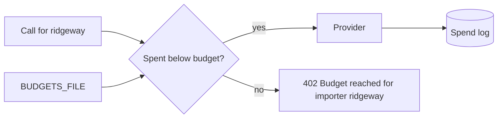
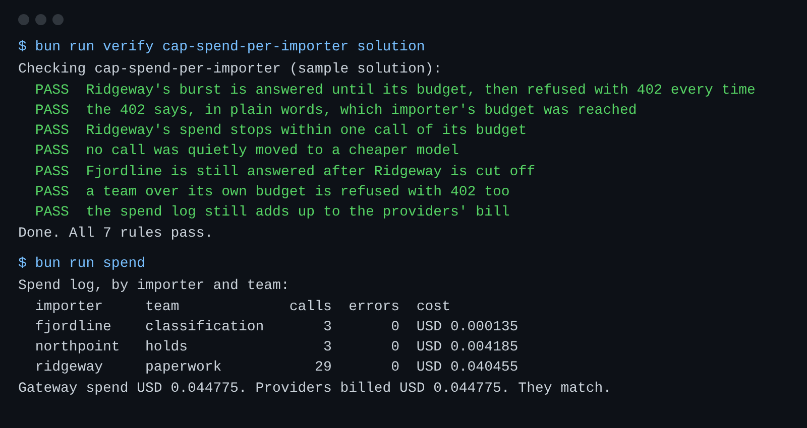

# Cap spend per importer

## The problem

Ridgeway Roasters ships a lot of coffee at once, a few times a year.
In one of these bursts, its agents can spend the whole model budget, and nothing stops them.
A gateway that quietly switches to a cheaper model is even worse.
The tariff codes get worse, and nobody is told.



## Your challenge

Read `BUDGETS_FILE`. It holds spend limits in micro-dollars, under `importers` and `teams`.

For example, `world/data/budgets.json` gives Ridgeway a small limit:

```json
"importers": { "fjordline": 2000000, "ridgeway": 40000, "northpoint": 2000000 }
```

40000 micro-dollars is 4 US cents.
Once Ridgeway's calls have cost that much, the next call for `ridgeway` gets 402 and this message:

```text
Budget reached for importer ridgeway. Finance must raise it before more model calls.
```

Calls for Fjordline still go through, because Fjordline has its own budget.

1. Keep a running total of spend per importer and per team.
2. Before you call a provider, check both totals. If either one has reached its limit, answer 402 and say which budget, in plain words.
3. Never change the role a team asked for to save money.

```bash
bun run verify cap-spend-per-importer
bun run spend
```

Expect: `Done. All 7 rules pass.`, then a spend table where Ridgeway stops near its budget.



## Done when

- Ridgeway's burst is answered until its budget is reached, then every call gets 402.
- The 402 names the importer and says a budget was reached.
- Ridgeway's spend stops within one call of its budget.
- No call was moved to a cheaper model, Fjordline keeps working, and a team over its own budget gets 402.

## If you get stuck

| What you see                           | Fix                                                                         |
| -------------------------------------- | --------------------------------------------------------------------------- |
| `FAIL ... refused with 402 every time` | Check the total before you call the provider, and add the cost right after. |
| `FAIL no call was quietly moved ...`   | Remove any code that changes `chatRequest.model` when money runs low.       |
| `FAIL a team over its own budget ...`  | Keep a second total keyed by team and check `budgets.teams`.                |

## Words you will use

- **Budget**: the most an importer or a team may spend on model calls before finance raises it.
- **402**: the HTTP status for "payment required". Here it means the budget is used up.
- **Silent downgrade**: answering with a cheaper model than asked, without telling anyone.
