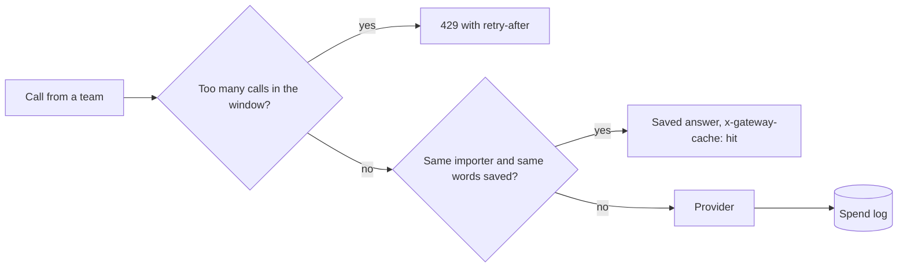

# Limit and cache calls

## The problem

One team's loop can call the gateway so fast that everyone waits. For example, the Paperwork agent asks the same question for
the same importer again and again. Each repeat is billed.

A gateway should slow a team that goes too fast. It should also not pay twice for an exact repeat.



## Watch it done

Run `bun run verify limit-and-cache-calls` on the starter, and see it fail. Then run it again with `solution` at the end, and
see it pass.

## Your turn

Start from your gateway after `cap-spend-per-importer`. The gateway reads two settings:

- `RATE_LIMIT`: the calls one team may make in a window.
- `RATE_WINDOW_MS`: how long the window lasts.

1. Keep the time of each call per team. When a team has made `RATE_LIMIT` calls inside the window, answer 429 with a
   `retry-after` header in seconds. Say "Try again in N seconds" in the message. Do this before you call any provider.
2. Save each answer under the importer, the role and the messages. When the same call comes again for the same importer,
   answer from memory and add the header `x-gateway-cache: hit`.
3. A saved answer is never shown to another importer. Put the importer in the key.

```bash
bun run verify limit-and-cache-calls
```

Expect: `Done. All 7 rules pass.`

## Do it on your work

Find one caller on your platform that can flood a shared service. Set a limit for it, and say which answers are safe to save.
Use your own files. A good answer gives proof for each line below.

## Done when

- A team's calls are answered until its limit. Then every call gets 429 with `retry-after`.
- A refused call never reaches a provider, and another team is still answered.
- An exact repeat for the same importer comes from memory and adds no provider call.
- The same words for another importer reach a provider.
- The spend log still adds up to the providers' bill.

## Solution

The after state is in `solution/`. Compare it with `diff -r problem/ solution/`.

## If you get stuck

| What you see                          | Fix                                                                 |
| ------------------------------------- | ------------------------------------------------------------------- |
| `FAIL ... the next one gets 429`      | Count calls per team and compare with `RATE_LIMIT` before the call. |
| `FAIL another team is still answered` | Key the list of call times by team name, not one list for everyone. |
| `FAIL ... another importer ...`       | Add the importer to the saved key.                                  |
| `FAIL the spend log ...`              | A hit adds no spend row, because no provider was paid.              |

## Words you will use

- **Rate limit**: the most calls one caller may make in a short window.
- **429**: the HTTP status for "too many requests". `retry-after` says how long to wait.
- **Cache**: a saved answer that is reused for an exact repeat.
