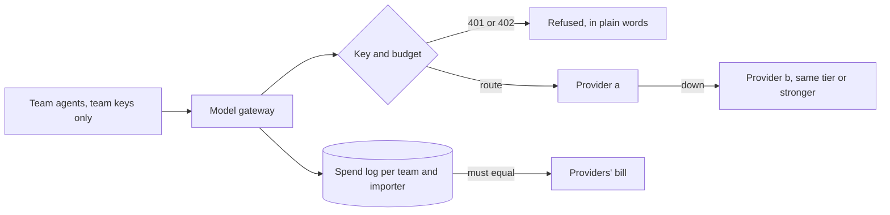

# Route model calls

## The problem

41 model calls went straight to a provider, three provider keys sit in team code, and nobody can bill
Ridgeway Roasters for its share. When provider a goes down, every agent stops. Large companies solve this
with one model gateway in front of every provider: Grab describes its AI Gateway, which hands out keys
per person and per service and tracks cost per request
([Grab Engineering](https://engineering.grab.com/grab-ai-gateway)).



| Step                          | Minutes | What you produce                                                                         | What its check reads                                                                                                  |
| ----------------------------- | ------- | ---------------------------------------------------------------------------------------- | --------------------------------------------------------------------------------------------------------------------- |
| `route-calls-through-gateway` | 20      | A gateway that checks team keys, calls the provider with the platform key and logs spend | Status codes, the provider's record of which key it saw, the spend log against the providers' bill, `teams/` for keys |
| `fall-back-on-outage`         | 15      | A route table with fallback that never goes to a weaker model                            | The `x-gateway-provider` header with provider a down, `provider_error` rows, whether a bad route table starts         |
| `cap-spend-per-importer`      | 20      | Budgets per importer and per team, refused with 402                                      | Status codes in a 40-call burst, spend per importer against its limit, the roles the provider billed                  |

Each step starts from the previous step's sample solution, so you can begin at any step.

## Walkthrough

```bash
bun run verify route-calls-through-gateway
bun run verify fall-back-on-outage
bun run verify cap-spend-per-importer
bun run verify part route-model-calls
```

Expect: each step ends `Done.` once your gateway is in place, then `Part route-model-calls is done: 3/3 steps pass.`

## Change it

- Make `fast` fall back to `smart` and confirm the gateway still starts. Then make `smart` fall back to `fast` and watch it refuse.
- At an enterprise, budgets live in a finance system and reset on a schedule. Where would you read them from, and what happens to a call in flight when the limit changes?
