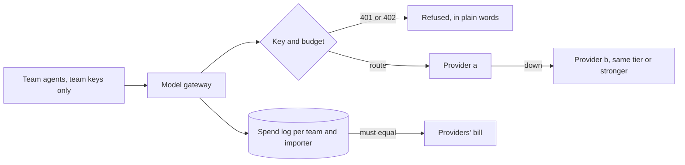

# Route model calls

## The problem

Today, 41 model calls went straight to a provider.
Three provider keys sit in team code.
Nobody can send Ridgeway Roasters a bill for its share.
And when provider a goes down, every agent stops.

Large companies fix this with one model gateway in front of every provider.
A model gateway is one service that every call to an AI model must pass through.
For example, Grab runs an AI Gateway.
It gives each person and each service its own key, and tracks the cost of every request
([Grab Engineering](https://engineering.grab.com/grab-ai-gateway)).

In this part you build that gateway for Harbourgate, in three steps.



| Step                          | Minutes | What you produce                                                                         | What its check reads                                                                                                  |
| ----------------------------- | ------- | ---------------------------------------------------------------------------------------- | --------------------------------------------------------------------------------------------------------------------- |
| `route-calls-through-gateway` | 20      | A gateway that checks team keys, calls the provider with the platform key and logs spend | Status codes, the provider's record of which key it saw, the spend log against the providers' bill, `teams/` for keys |
| `fall-back-on-outage`         | 15      | A route table with fallback that never goes to a weaker model                            | The `x-gateway-provider` header with provider a down, `provider_error` rows, whether a bad route table starts         |
| `cap-spend-per-importer`      | 20      | Budgets per importer and per team, refused with 402                                      | Status codes in a 40-call burst, spend per importer against its limit, the roles the provider billed                  |

Each step starts from the sample answer of the step before it.
So you can begin at any step.

## Walkthrough

```bash
bun run verify route-calls-through-gateway
bun run verify fall-back-on-outage
bun run verify cap-spend-per-importer
bun run verify part route-model-calls
```

Expect: each step ends `Done.` once your gateway is in place, then `Part route-model-calls is done: 3/3 steps pass.`

## Change it

- Make `fast` fall back to `smart`, and check that the gateway still starts. Then make `smart` fall back to `fast`, and watch it refuse to start.
- In a large company, budgets live in a finance system and start again each month. Where would your gateway read them from? What happens to a call that is already running when the limit changes?

## Finished

You now have one model gateway in front of every provider.
Teams send their own team key, and only the gateway holds the provider keys.
Every call writes a spend row, and the spend log adds up to the providers' bill.
When provider a is down, calls go to provider b, never to a weaker model.
When an importer's budget is used up, the gateway answers 402 in plain words.

The next part, `police-tool-calls`, does the same for tool calls: one gateway decides which agent may call which tool.
