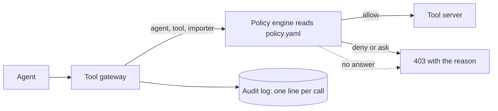
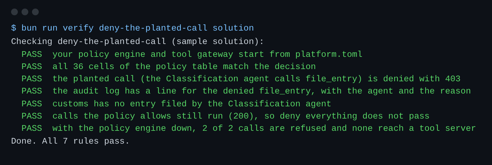

# Deny the planted call

## The problem

The legacy Classification script filed two rush entries, `HG-1049` and `HG-1053`, by itself.
No licensed broker signed the codes.
That breaks the one legal rule in this world.

A sentence in a prompt such as "never file" does not stop this.
A model can ignore it, or a hidden instruction in an invoice can undo it.
So the rule must live outside the model, in a policy engine.
A policy engine is a small service that answers one question: may this agent call this tool?



## Your challenge

`policy.ts` is the engine. It is done. It reads the rules in `policy.yaml`.
Today `policy.yaml` lets every agent call every tool.

1. Write the real rules in `policy.yaml`. Read what each team may do in `world/data/teams.json`. Anything you leave out is denied.
2. Put `file_entry` under `ask` for the `paperwork-agent`. A licensed broker must sign first. The next step makes `ask` work. For now the gateway refuses it.
3. In `tool-gateway.ts`, make `decide()` fail closed: if the engine does not answer, refuse the call.
4. Finish `writeAuditLine()`. Write one line per call to `LEDGER_URL/spans`, allowed or not.

For example, the Classification agent asks to call `file_entry` for `HG-1049`.
Your gateway asks the engine: `{ "agent": "classification-agent", "tool": "file_entry", "importer": "fjordline" }`.
The engine answers `{ "decision": "deny", "reason": "denied: classification-agent may not call file_entry" }`.
The gateway answers the agent with 403 and that reason.
The audit log gets a line with the tool, the agent and the reason.

The check asks your engine about all 36 pairs of agent and tool.
Then it stops the engine and makes sure your gateway refuses every call.

```bash
bun run verify deny-the-planted-call
```

Expect: `Done. All 7 rules pass.`



## Done when

- All 36 cells of the policy table match: each agent may call only its own tools.
- The planted `file_entry` call is denied, and the audit log shows why.
- Allowed calls still run, so "deny everything" fails.
- With the policy engine down, 2 of 2 calls are refused.

## If you get stuck

| What you see                                  | Fix                                                                               |
| --------------------------------------------- | --------------------------------------------------------------------------------- |
| `FAIL all 36 cells of the policy table match` | Remove `"*"`. List each agent's tools by name. Put `file_entry` under `ask` only. |
| `FAIL calls the policy allows still run`      | Denying everything is safe but useless. Allow each team's own tools.              |
| `FAIL with the policy engine down ...`        | In the `catch` of `decide()`, return `deny`, not `allow`.                         |

## Words you will use

- **Policy**: the written rules for who may do what. Here it is `policy.yaml`.
- **Deny by default**: anything the rules do not name is refused.
- **Fail closed**: when the checker is down, refuse. Fail open would let everything through.
- **Audit log**: a record of every call and its decision, so you can prove later what happened.
