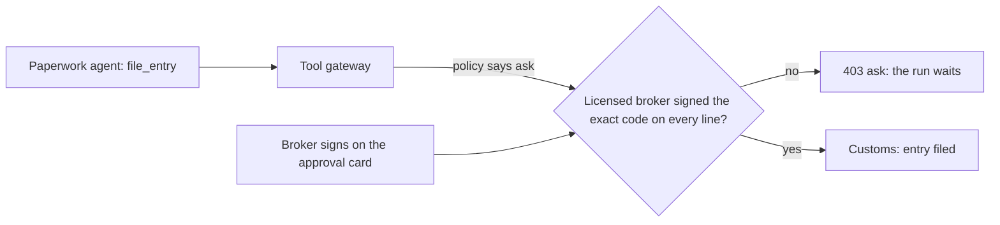
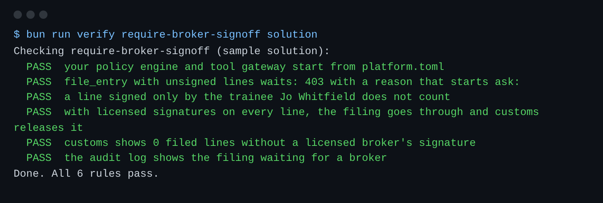

# Require broker sign-off

## The problem

The Paperwork agent may file entries, but only after a licensed broker signs every tariff code.
A licensed broker is a person who holds a customs broker licence.
In this world, Amara Okafor and Tomas Reyes are licensed. Jo Whitfield is a trainee.

Your policy already says `ask` for `file_entry`.
Today the gateway refuses every `ask`, so no entry is ever filed.
Harbourgate cannot clear any goods.



## Your challenge

Make `ask` work for `file_entry`.

1. When the policy says `ask`, read the proposals for the shipment with the `read_proposals` tool. Each proposal shows its line, its code and the broker who signed it.
2. A line counts as signed only when the code on the filing matches the signed code, and the broker is licensed in `BROKERS_FILE`.
3. If every line counts, change the decision to `allow` and forward the call.
4. If not, refuse with 403 and a reason that starts `ask:`. The agent waits and tries again later.

For example, the Paperwork agent files `HG-1052` with three lines.
At first nobody has signed, so your gateway answers `ask: a licensed broker must sign 3 line(s) before filing`.
Then Amara Okafor signs lines 1 and 2.
An old system also copied in a signature from Jo Whitfield for line 3.
Jo is not licensed, so line 3 still does not count. The answer is `ask: ... 1 line(s) ...`.
Then Tomas Reyes signs line 3. Now the filing goes through, and customs releases `HG-1052`.

```bash
bun run verify require-broker-signoff
bun run verify part police-tool-calls
```

Expect: `Done. All 6 rules pass.`, then `Part police-tool-calls is done: 3/3 steps pass.`



## Done when

- A filing with an unsigned line gets 403 with `ask:`, and customs records nothing.
- A trainee's signature does not count.
- Once licensed brokers sign every line, the filing goes through and customs releases it.
- Customs shows 0 filed lines without a licensed broker's signature.

## If you get stuck

| What you see                                      | Fix                                                                              |
| ------------------------------------------------- | -------------------------------------------------------------------------------- |
| `FAIL with licensed signatures on every line ...` | Read the request body once. Use the same text to decide and to forward.          |
| `FAIL a line signed only by the trainee ...`      | A broker name on a proposal is not enough. Look the broker up in `BROKERS_FILE`. |
| `FAIL the audit log shows the filing waiting ...` | Write the audit line after you resolve the ask, so it holds the final reason.    |

## Words you will use

- **Ask**: a policy result that means "a person must approve first". It sits between allow and deny.
- **Sign-off**: a licensed person's approval of one exact result, here one code on one line.
- **Licence list**: the people allowed to sign, in `world/data/brokers.json`. A name that is not on it never counts.
