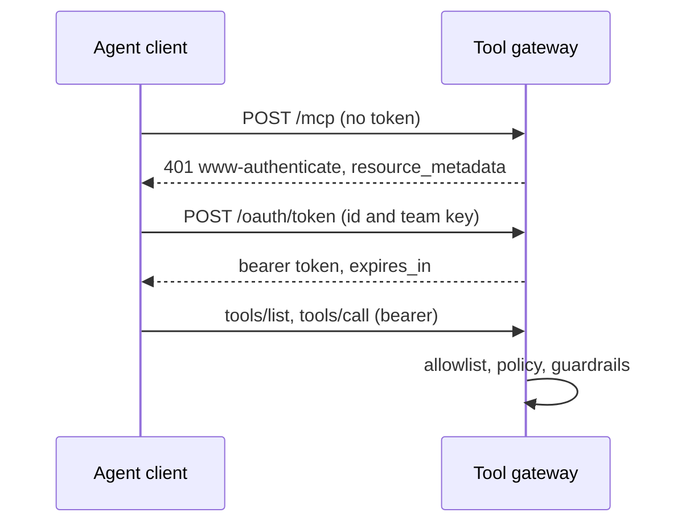

# Serve tools over MCP with OAuth

## The problem

Real agent tools speak MCP, a shared way for an agent to list and call tools.
Your gateway so far has its own plain paths and a long-lived team key.
For example, a real MCP client expects JSON-RPC, a short-lived token, and a 401 that says where to get one.



## Your challenge

Start from your gateway after `add-a-guardrail-layer`. Keep every old path working, and add three things.

1. `GET /.well-known/oauth-protected-resource` returns `resource` and `authorization_servers`.
2. `POST /oauth/token` takes `grant_type`, `client_id` (the agent) and `client_secret` (its team key). It returns `access_token`, `token_type` and `expires_in`. A wrong secret gets 401. The `TOKEN_SECONDS` setting sets the life of a token.
3. `POST /mcp` takes JSON-RPC. Support `initialize`, `tools/list` and `tools/call`. With no valid token, answer 401 and a `www-authenticate: Bearer resource_metadata="..."` header.

A `tools/call` goes through the same allowlist, policy and guardrails as a plain call. A refused call comes back as a result with `isError: true`. Never pass the bearer token on to a tool server. An unknown method gets an error with code `-32601` and the same `id`.

```bash
bun run verify serve-tools-over-mcp
```

Expect: `Done. All 8 rules pass.`

## Done when

- The metadata path, the token path and `/mcp` all answer as above.
- `tools/list` shows only approved tools, each with an `inputSchema`.
- A tool outside the allowlist, and a tool the policy denies, come back as errors and never reach a tool server.
- The tool server sees the agent name, and no bearer token.
- A token is refused once it has expired.

## If you get stuck

| What you see                         | Fix                                                                      |
| ------------------------------------ | ------------------------------------------------------------------------ |
| `FAIL POST /mcp without a token ...` | Add the `www-authenticate` header to the 401.                            |
| `FAIL ... an approved tool runs ...` | Send `x-agent` and `x-importer` upstream, and no `authorization` header. |
| `FAIL ... never reach a tool server` | Call the same function the plain path uses, not the tool server direct.  |
| `FAIL an expired token ...`          | Store an expiry time with each token and compare it on every call.       |

## Words you will use

- **MCP**: a shared way for agents to list and call tools, using JSON-RPC messages.
- **OAuth**: a way to trade a long-lived secret for a short-lived token.
- **Allowlist**: the short list of tools an agent may ever see.
