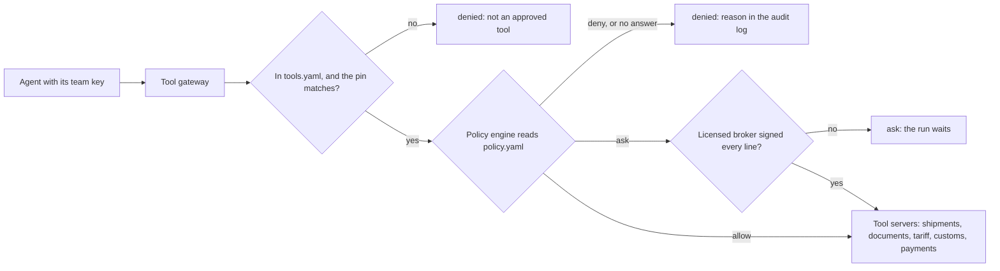

# Police tool calls

## After this part you can

Make a tool gateway decide which agent may call which tool, outside the model, and keep an audit line for every call.

## You leave with

A `tools.yaml`, a `policy.yaml`, a `guardrails.yaml` and a tool gateway with a broker sign-off path.

## The problem

The report card says 121 tool calls left no record of who asked.
The legacy Classification script even filed two rush entries, `HG-1049` and `HG-1053`, by itself.
That breaks the one legal rule in this world: a licensed broker signs every tariff code before filing.

Rules written in a prompt do not hold.
A model can skip them, and a hidden instruction in an invoice can undo them.
So the platform decides which agent may call which tool, outside the model.
For example, the Classification agent asks to call `file_entry`.
The tool gateway answers "denied: classification-agent may not call file_entry", and writes that in the audit log.

## Why it matters

DoorDash runs one gateway that every agent uses to find and call tools.
So access and secrets live in one place ([DoorDash Engineering](https://careersatdoordash.com/blog/how-doordash-built-a-centralized-gateway-for-ai-agent-tool-access/)).
Uber runs a gateway for MCP servers, the servers that offer tools to agents.
It keeps a list of the servers, and a new tool starts switched off ([Uber Engineering](https://www.uber.com/us/en/blog/designing-mcp-gateway/)).



| Step                      | Minutes | What you produce                                                                              | What its check reads                                                                                                          |
| ------------------------- | ------- | --------------------------------------------------------------------------------------------- | ----------------------------------------------------------------------------------------------------------------------------- |
| `register-approved-tools` | 15      | `tools.yaml` with a pin for each approved tool; the gateway lists only those                  | `GET /tools` before and after a vendor update; which calls reached the tool servers; what your gateway printed                |
| `deny-the-planted-call`   | 20      | `policy.yaml` rules; a gateway that fails closed and writes an audit line                     | All 36 cells of the policy table; the audit line for the planted `file_entry`; customs entries; calls with the engine stopped |
| `require-broker-signoff`  | 15      | An `ask` path: filing waits until a licensed broker signed the code on each line              | Status codes as brokers sign; a trainee's signature; customs entries and their signatures; the audit log                      |
| `add-a-guardrail-layer`   | 20      | `guardrails.yaml` rules; a gateway that blocks bad words in a call and cleans a tool's answer | The tool server's received calls; the answer for `HG-1055`; audit lines with the word guardrail; a new rule added to the file |
| `serve-tools-over-mcp`    | 25      | An MCP endpoint behind OAuth: a token path, metadata, `tools/list` and `tools/call`           | The 401 header; the token and its expiry; the tools listed; what the tool server received, with no bearer token               |

Each step starts from the sample answer of the step before it.
So you can begin at any step.

## Watch and read

| Kind  | Title                                                              | Author              | Why                                                                      | Link                                                   |
| ----- | ------------------------------------------------------------------ | ------------------- | ------------------------------------------------------------------------ | ------------------------------------------------------ |
| video | Securing AI Agents: How to Prevent Hidden Prompt Injection Attacks | IBM Technology      | Shows how a hidden instruction can push an agent into a bad tool call.   | https://www.youtube.com/watch?v=5ZA1lTxTH3c            |
| video | Episode 1: What is AI Red Teaming?                                 | Microsoft Developer | Shows how testers try to make an AI system break its own rules.          | https://www.youtube.com/watch?v=DabrWAKNQZc            |
| read  | Open Policy Agent documentation                                    | Open Policy Agent   | Shows a policy engine that answers yes or no outside the app.            | https://www.openpolicyagent.org/docs                   |
| read  | Designing an MCP gateway                                           | Uber Engineering    | Shows a gateway for tool servers that starts each new tool switched off. | https://www.uber.com/us/en/blog/designing-mcp-gateway/ |

## Project

List the tools one of your own agents can call. Mark each one as allow, ask or deny, and write the one rule you would put in a policy file first.

## Walkthrough

Start in the first step's folder. See the tools the servers offer today, with their pins:

```bash
cd parts/02-police-tool-calls/01-register-approved-tools/problem
bun list-tools.ts
```

Expect: a list that starts "# server: shipments" and ends with `export_all_documents`, each tool with a `pin: sha256:...` line.

Go back to the repo root. Then check each step after you finish it:

```bash
cd ../../../..
bun run verify register-approved-tools
bun run verify deny-the-planted-call
bun run verify require-broker-signoff
bun run verify add-a-guardrail-layer
bun run verify serve-tools-over-mcp
```

Expect: each step ends `Done.` once your work is in place, for example `Done. All 8 rules pass.` for the first step.

Last, check the whole part:

```bash
bun run verify part police-tool-calls
```

Expect: `Part police-tool-calls is done: 5/5 steps pass.`, after these lines:

```text
Part police-tool-calls:
  PASS   register-approved-tools  (8/8 rules)
  PASS   deny-the-planted-call  (7/7 rules)
  PASS   require-broker-signoff  (6/6 rules)
  PASS   add-a-guardrail-layer  (6/6 rules)
  PASS   serve-tools-over-mcp  (8/8 rules)
```

## Finished

You now have a tool gateway that every agent call passes through.
It runs only approved tools, and hides a tool whose words changed.
A policy engine outside the model decides each call, and the gateway refuses when the engine is down.
Every call leaves an audit line, and no entry reaches customs without a licensed broker's signature.

One gap is left. The gateway knows a caller only by its team key, and the key is a long-lived secret.
In the next part, `identify-each-agent`, each agent gets its own short-lived token.
Then the audit log can prove which agent acted, for which importer, and for which broker.

## Assignment

The problem: the Classification agent filed an entry itself, which breaks the broker rule.

- **Hand in**: a pull request on your fork with `tools.yaml`, `policy.yaml` and your tool gateway with the `ask` path.
- **Rubric** (each line is yes or no, and all must be yes):
  - Does `bun run verify register-approved-tools` pass?
  - Does `bun run verify deny-the-planted-call` pass?
  - Does `bun run verify require-broker-signoff` pass?
- **Extension**: payments above a set amount of duty need a second licensed broker. Add that `ask` and test it.

## Change it

- Give the policy an importer rule. For example, only the Holds agent may book exams, and only for importers with an open hold.
- A vendor fixes a typo in a tool's description. What should a person check before they update the pin?
