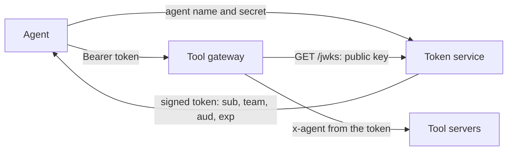
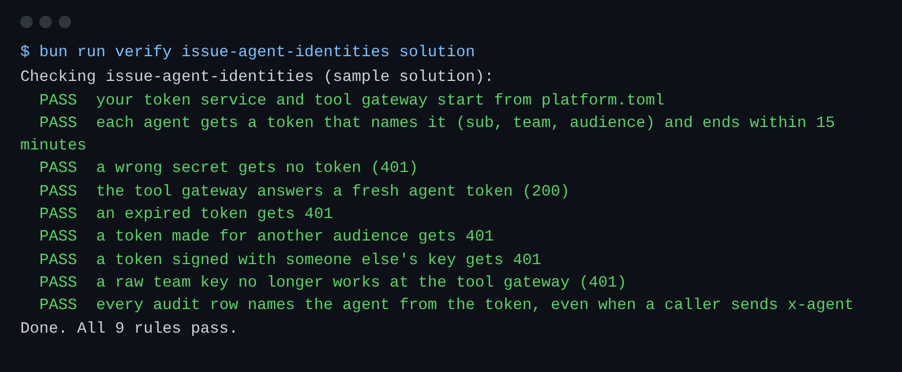

# Issue agent identities

## The problem

Every tool call carries a team key, such as `hgk_paperwork_b2c604`.
A team key is a long-lived secret. It never ends, and every tool server sees it.
If one leaks, anyone can act as that team until someone notices.

The tool gateway also passes on the `x-agent` header that the caller wrote.
So any caller can claim to be the Holds agent, and the audit log believes it.



## Your challenge

Give each agent its own short-lived token, and accept nothing else at the tool gateway.

1. In `token-service.ts`, finish `issueToken()`. Check the agent and secret against `TEAMS_FILE`. Answer 401 if they do not match.
2. Sign a token with `SignJWT` from `jose`: subject is the agent, a `team` claim, issuer `harbourgate-tokens`, audience `harbourgate-tools`, and an expiry after `LIFETIME_SECONDS`. That constant is already at the top of `token-service.ts`.
3. In `tool-gateway.ts`, drop the team keys. Check each token with `jwtVerify` against `TOKENS_URL/jwks`, with the issuer and audience above.
4. Set `x-agent` from the token's `sub`, never from the caller's headers.

The key pair and `/jwks` are already done in `token-service.ts`.

For example, the Paperwork agent sends `{ "agent": "paperwork-agent", "secret": "hgk_paperwork_b2c604" }` to `/token`.
It gets back a token. Decoded, the token says:

```json
{ "sub": "paperwork-agent", "team": "paperwork", "aud": "harbourgate-tools", "exp": 1789000300 }
```

The agent then calls `read_shipment` with `Authorization: Bearer <token>`.
Five minutes later the token has ended, and the same call gets 401.

```bash
bun run verify issue-agent-identities
```

Expect: `Done. All 9 rules pass.`



## Done when

- Each agent gets a token that names it and ends within 15 minutes.
- A wrong secret, an expired token, a token for another audience and a forged token all get 401.
- A raw team key no longer works at the tool gateway.
- Every audit row names the agent from the token.

## If you get stuck

| What you see                                  | Fix                                                                                                                     |
| --------------------------------------------- | ----------------------------------------------------------------------------------------------------------------------- |
| `FAIL an expired token gets 401`              | Use the `LIFETIME_SECONDS` constant for the expiry. It reads `TOKEN_TTL_SECONDS`, and the check sets that to 2 seconds. |
| `FAIL a token made for another audience ...`  | Pass `audience: "harbourgate-tools"` to `jwtVerify`.                                                                    |
| `FAIL a token signed with someone else's key` | `decodeJwt` only reads a token. `jwtVerify` checks the signature too.                                                   |

## Words you will use

- **Token**: a signed note that says who you are and when the note ends. Here it is a JWT.
- **Claim**: one fact inside a token, such as `sub` (who) or `exp` (when it ends).
- **Audience**: who a token is for. A token for billing must not work at the tool gateway.
- **JWKS**: the public keys of the token service. Anyone can check a signature with them, but nobody can sign.
