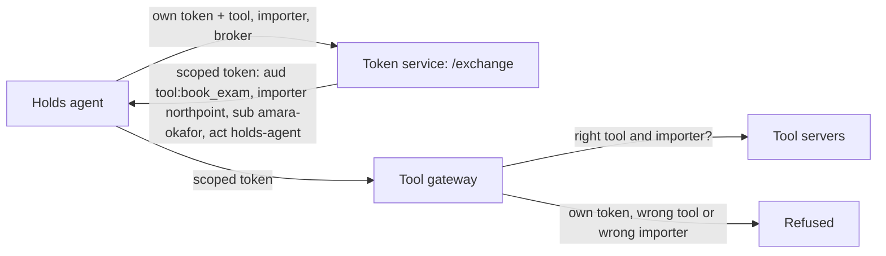
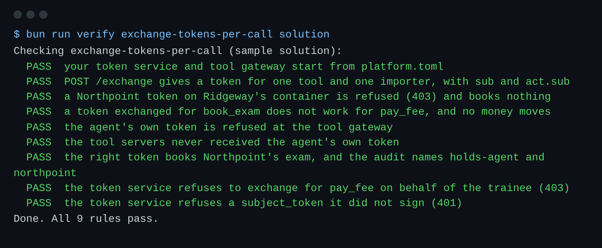

# Exchange tokens per call

## The problem

Each agent now has its own token. But one token still opens every door.
The Holds agent's token works for any tool, for any importer.
If it leaks from one tool server, anyone can pay fees for any importer's container.

The audit log also misses one fact: which broker the agent was working for.
A broker is the person who owns the client file, and who answers for it.



## Your challenge

Before each tool call, the agent swaps its own token for a scoped one.
A scoped token works for one tool and one importer, on behalf of one broker.

1. In `token-service.ts`, finish `exchangeToken()`. Check `subject_token` with `jwtVerify`, or answer 401.
2. Refuse with 403 when `on_behalf_of` is not a broker, or is not licensed for a tool in `BROKER_ONLY_TOOLS`.
3. Sign the scoped token. `sub` is the broker. `act: { sub }` is the agent. Add `importer`, and audience `tool:<tool>`.
4. In `tool-gateway.ts`, accept only audience `tool:<name>` for the tool in the URL. Refuse the agent's own token.
5. Refuse a call when the shipment belongs to another importer. Set `x-agent` from `act.sub` and `x-importer` from the token.
6. Never pass the agent's own token on to a tool server.

This shape comes from token exchange in RFC 8693, a public standard.

For example, the Holds agent sends this to `/exchange`:

```json
{
  "subject_token": "<its own token>",
  "tool": "book_exam",
  "importer": "northpoint",
  "on_behalf_of": "amara-okafor"
}
```

It gets back a token for `book_exam` on Northpoint's containers only.
With it, booking the exam on `HG-1057` (Northpoint) works.
Booking on `HG-1050` (Ridgeway) gets 403. Paying a fee with it is refused too.

```bash
bun run verify exchange-tokens-per-call
bun run verify part identify-each-agent
```

Expect: `Done. All 9 rules pass.`, then `Part identify-each-agent is done: 2/2 steps pass.`



## Done when

- `/exchange` gives a token for one tool and one importer, with the broker in `sub` and the agent in `act`.
- The token fails on another importer's container, on another tool, and the agent's own token fails at the gateway.
- No tool server ever receives the agent's own token.
- An exchange for `pay_fee` on behalf of the trainee is refused.

## If you get stuck

| What you see                                | Fix                                                                                 |
| ------------------------------------------- | ----------------------------------------------------------------------------------- |
| `FAIL a Northpoint token on Ridgeway's ...` | Ask the world who owns `shipment_id`, then compare it with the token's `importer`.  |
| `FAIL the agent's own token is refused ...` | The audience must be exactly `tool:<name>`. Do not also accept `harbourgate-tools`. |
| `FAIL the tool servers never received ...`  | Build new headers. Do not copy the caller's `authorization` header.                 |

## Words you will use

- **Token exchange**: trading one token for another, narrower one.
- **Scope**: what a token may be used for. Here: one tool and one importer.
- **Actor chain**: who acted for whom. `sub` is the broker, `act.sub` is the agent acting for the broker.
- **Passthrough**: sending the caller's own token on to the next service. It spreads a powerful secret.
