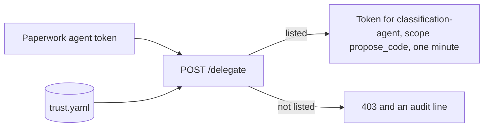

# Trust another agent

## The problem

Sooner or later one agent asks another for help.
For example, the Paperwork agent wants a tariff code from the Classification agent.
If the Classification agent believes any caller, then the Holds agent can ask it for things it must never get.
Agents need the same care between each other as they get from people.



## Watch it done

Run `bun run verify trust-another-agent` on the starter and see it fail. Run it again with `solution` on the end and see it pass.

## Your turn

Start from your token service after `exchange-tokens-per-call`. Fill `trust.yaml` and add `POST /delegate`.
It takes `subject_token` (the asking agent's own token), `target` (the other agent) and `tools` (what it needs).

1. In `trust.yaml`, let `paperwork-agent` ask `classification-agent` for `propose_code` and `lookup_tariff`. Nobody else may ask anyone.
2. On a listed ask, sign a token. Its `sub` is the asking agent, its audience is `agent:<target>`, its `scope` is the tools, and it ends within one minute.
3. Refuse with 403 an agent that is not listed, and refuse an ask for any tool outside the list.
4. Accept only an agent's own token. A delegated token cannot hand the work on.
5. Write one audit line for every ask, allowed or refused.
6. Read `trust.yaml` when the service starts, so a new line needs no code change.

```bash
bun run verify trust-another-agent
```

Expect: `Done. All 8 rules pass.`

## Do it on your work

Pick two agents that talk to each other. Write what the receiver checks before it believes the sender. Use your own files. Good looks like proof for each line below.

## Done when

- Paperwork gets a token for Classification, with the right audience and scope.
- The Holds agent is refused, and so is an ask for a tool outside the list.
- A delegated token cannot be used to ask a third agent.
- Every ask has an audit line.

## Solution

The after state is in `solution/`. Compare it with `diff -r problem/ solution/`.

## If you get stuck

| What you see                       | Fix                                                                       |
| ---------------------------------- | ------------------------------------------------------------------------- |
| `FAIL ... token is for the other`  | Set the audience to `agent:classification-agent` and add a `scope` claim. |
| `FAIL an agent that is not listed` | Look up the caller, then the target. No line means 403.                   |
| `FAIL ... hand the work on`        | In `/delegate`, check the audience of the token you were given.           |
| `FAIL ... no code change`          | Do not write the pairs in code. Read the file.                            |

## Words you will use

- **Delegation**: one agent handing a piece of work to another, with only the power that piece needs.
- **Scope**: the list of things a token allows.
- **Audience**: who a token is made for. Any other reader must refuse it.
