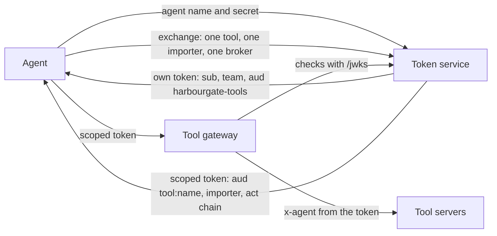

# Identify each agent

## The problem

All three agents act under one shared identity: a team key that never ends.
So the audit log says "agent" and nothing more.
For example, the Holds agent pays an exam fee for Northpoint.
Nobody can prove which agent paid, for which importer, or for which broker.
And any caller can write `x-agent: holds-agent` in a header, and the log believes it.

## Why it matters

Uber gives each agent its own identity.
Each agent gets tokens that end after a short time.
A token is a signed note that says who you are.
Uber's tokens also carry the chain of who acted for whom ([Uber Engineering](https://www.uber.com/blog/solving-the-agent-identity-crisis/)).



| Step                       | Minutes | What you produce                                                                                   | What its check reads                                                                                                                            |
| -------------------------- | ------- | -------------------------------------------------------------------------------------------------- | ----------------------------------------------------------------------------------------------------------------------------------------------- |
| `issue-agent-identities`   | 15      | A token service that issues each agent a signed, short-lived token; a gateway that accepts only it | The token claims; 401 for a wrong secret, an expired token, the wrong audience, a forged token and a raw team key; the agent on every audit row |
| `exchange-tokens-per-call` | 20      | Token exchange: one tool, one importer, on behalf of one broker (`act`)                            | 403 for a Northpoint token on a Ridgeway container; a token for the wrong tool; holds and payments; what the tool servers received              |

In this part the tool gateway is cut down to one job: identity.
The catalog and the policy from `police-tool-calls` sit in front of it in the full platform.

## Walkthrough

Check each step after you finish it, from the repo root:

```bash
bun run verify issue-agent-identities
bun run verify exchange-tokens-per-call
```

Expect: each step ends `Done.` once your work is in place, for example `Done. All 9 rules pass.`

To see a real token, start your token service in the second step's folder:

```bash
cd parts/03-identify-each-agent/02-exchange-tokens-per-call/problem
TEAMS_FILE=../../../../world/data/teams.json BROKERS_FILE=../../../../world/data/brokers.json PORT=4200 bun token-service.ts &
sleep 1
curl -s -X POST localhost:4200/token -d '{"agent":"holds-agent","secret":"hgk_holds_e95d12"}'
kill %1
cd ../../../..
```

Expect: `{"token":"eyJ...` with a long token.

A JWT is three parts joined by dots. The middle part holds the claims.
To read them, decode the token on your own machine. Do not paste a real token into a website.

```bash
bun -e 'import { decodeJwt } from "jose"; console.log(decodeJwt(process.argv[1]))' PASTE_THE_TOKEN_HERE
```

Expect: an object with `sub: "holds-agent"`, `team: "holds"`, `aud: "harbourgate-tools"` and `exp`.

Last, check the whole part:

```bash
bun run verify part identify-each-agent
```

Expect: `Part identify-each-agent is done: 2/2 steps pass.`, after these lines:

```text
Part identify-each-agent:
  PASS   issue-agent-identities  (9/9 rules)
  PASS   exchange-tokens-per-call  (9/9 rules)
```

## Finished

Each agent now has its own identity, proven by a signature, and it ends in minutes.
Before each call, the agent trades it for a token that fits one tool, one importer and one broker.
The tool servers never see the agent's own token.
The audit log names the agent and the importer from a token nobody can fake.

The tokens say which importer a call is for. But the data underneath is still one shared pile.
In the next part, `separate-importer-data`, the database itself refuses to show one importer's rows to another.

## Assignment

The problem: the audit log says "agent" and nothing more.

- **Hand in**: a pull request on your fork with the token service (`/token`, `/exchange`, `/jwks`) and the tool gateway that reads the `act` claim.
- **Rubric** (each line is yes or no; all must be yes):
  - Does `bun run verify issue-agent-identities` pass?
  - Does `bun run verify exchange-tokens-per-call` pass?
- **Extension**: rotate the signing key with no failed call. Publish the old and the new key in `/jwks` for a while.

## Change it

- Make exchanged tokens last 10 seconds. What happens to a slow tool call?
- Add a `run` claim to the scoped token. How would that help the trace in a later part?
