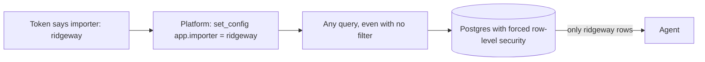
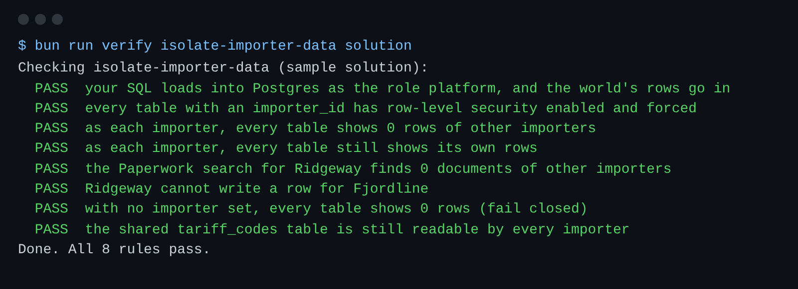

# Isolate importer data

## The problem

Harbourgate keeps every importer's papers in one database.
The Paperwork agent's search does not say which importer it works for.
So while it drafts an entry for Ridgeway, it can read Fjordline's invoices and prices.

Every team could remember to add `WHERE importer_id = ...` to every query.
One forgotten filter is enough for a leak. So the database itself must refuse.



## Your challenge

Turn on row-level security in `schema.sql`.
Row-level security is a Postgres feature: a policy decides which rows each query can see.

1. For `shipments`, `invoice_lines` and `documents`, add `ENABLE ROW LEVEL SECURITY`.
2. Add `FORCE ROW LEVEL SECURITY` too. The platform owns these tables, and without FORCE the owner sees every row.
3. Add a policy that shows and accepts only rows where `importer_id = current_setting('app.importer', true)`. Use `USING` for reading and `WITH CHECK` for writing.
4. Leave `tariff_codes` alone. It has no importer, and every importer may read it.

The check runs your SQL as the role `platform` in Postgres. Then it fills the tables with the world's 60 shipments.
For each importer it sets `app.importer`, the way the platform does for each connection.

For example, the Paperwork search runs as Ridgeway:

```sql
SELECT id FROM documents WHERE body ILIKE '%invoice%';
```

Before your change, it returns 39 invoices from Fjordline and Northpoint.
After it, it returns only Ridgeway's own invoices, though the query has no importer filter.

```bash
bun run verify isolate-importer-data
```

Expect: `Done. All 8 rules pass.`



## Done when

- Every table with an `importer_id` has row-level security enabled and forced.
- As each importer, every table shows 0 rows of other importers, and still shows its own.
- Ridgeway cannot write a row for Fjordline.
- With no importer set, every table is empty.
- Every importer can still read `tariff_codes`.

## If you get stuck

| What you see                                     | Fix                                                                            |
| ------------------------------------------------ | ------------------------------------------------------------------------------ |
| `FAIL ... enabled and forced`                    | ENABLE alone does not cover the table's owner. Add `FORCE ROW LEVEL SECURITY`. |
| `FAIL Ridgeway cannot write a row for Fjordline` | `USING` covers reads only. Add `WITH CHECK` with the same test.                |
| `FAIL your SQL loads ...`                        | Read the Postgres error in the output. Each statement ends with `;`.           |

## Words you will use

- **Tenant**: one client of a shared system. Here each importer is a tenant.
- **Row-level security**: rules in Postgres that pick which rows a query can see or write.
- **Policy**: one such rule, for example "only rows of this importer".
- **Table owner**: the role that created the table. Postgres skips row-level security for the owner unless you FORCE it.
