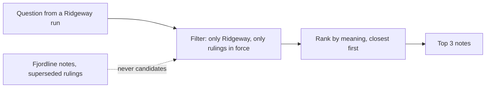
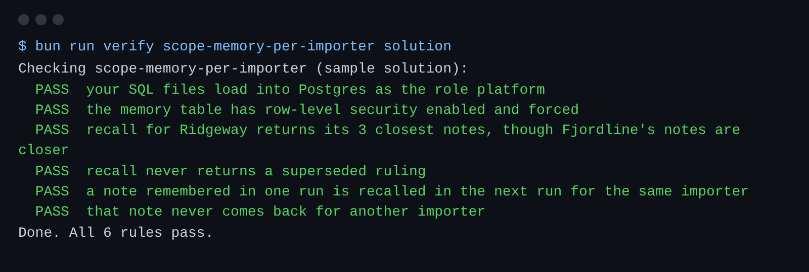

# Scope memory per importer

## The problem

Agents keep a memory: past rulings and broker notes.
They find a note by meaning, not by exact words.
Each note has an embedding: a list of numbers for its meaning. Close lists mean close meanings.

Today `recall()` ranks every note of every importer.
So when the Classification agent asks about Ridgeway's decaf beans, Fjordline's notes can come first.
And an old ruling that a newer one replaced still comes back. It can send goods to a wrong code.



## Your challenge

Change `memory.sql`. `schema.sql` is the answer from the last step. Leave it as it is.

1. Give the `memory` table row-level security: ENABLE, FORCE and the same policy as the other importer tables.
2. In `recall()`, add `WHERE memory.superseded_by IS NULL` before `ORDER BY`.
3. Keep the filter before the ranking and the `LIMIT`. Never take the top results first and filter them after.

For example, the check plants these notes and asks Ridgeway's question:

| Note     | Importer  | Words                      | Distance from the question |
| -------- | --------- | -------------------------- | -------------------------- |
| `mem-f1` | fjordline | Tents of nylon: ST-6306-22 | 0.05                       |
| `mem-r0` | ridgeway  | Decaf beans: ST-0901-11    | 0.25, superseded by r1     |
| `mem-r1` | ridgeway  | Decaf beans: ST-0901-12    | 0.6                        |

The right answer for the 3 closest notes is `mem-r1`, `mem-r2` and `mem-r3`.
If you rank first and filter after, the top 3 are all Fjordline's. After the filter, Ridgeway gets nothing.

The check also saves a note with `remember()` in one run, and asks for it in the next run.
Ridgeway finds it. Fjordline never does.

```bash
bun run verify scope-memory-per-importer
bun run verify part separate-importer-data
```

Expect: `Done. All 6 rules pass.`, then `Part separate-importer-data is done: 2/2 steps pass.`



## Done when

- The `memory` table has row-level security enabled and forced.
- Recall for Ridgeway gives its own 3 closest notes, though Fjordline's notes sit closer.
- A superseded ruling never comes back.
- A note saved in one run is found in the next run, for the same importer only.

## If you get stuck

| What you see                                        | Fix                                                                       |
| --------------------------------------------------- | ------------------------------------------------------------------------- |
| `FAIL recall for Ridgeway returns its 3 closest...` | The filter must run before `LIMIT`. Row-level security does that for you. |
| `FAIL recall never returns a superseded ruling`     | Put `superseded_by IS NULL` in the `WHERE` of `recall()`.                 |

## Words you will use

- **Embedding**: a list of numbers that stands for the meaning of a text.
- **Recall**: finding the notes closest in meaning to a question.
- **Superseded**: replaced by a newer ruling. The old one must not guide new work.
- **pgvector**: a Postgres extension that stores embeddings and ranks them by distance with `<->`.
