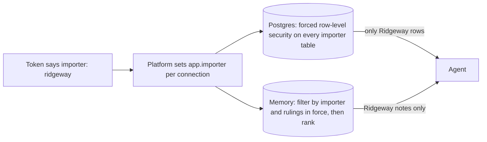

# Separate importer data

## The problem

The report card says the Paperwork agent read 36 documents that belong to other importers.
Its search did not care which importer the work was for.
For example, while it drafted an entry for Ridgeway, it could read Fjordline's invoices and prices.
A broker must keep each client's papers private, so this breaks the broker's duty.

Agent memory has the same gap. A search by meaning ranks every importer's notes together.

## Why it matters

AWS writes about agents that serve many customers on Bedrock AgentCore.
Keeping each customer's data apart is still the builder's job ([AWS Machine Learning Blog](https://aws.amazon.com/blogs/machine-learning/building-multi-tenant-agents-with-amazon-bedrock-agentcore/)).



| Step                        | Minutes | What you produce                                                                     | What its check reads                                                                                                              |
| --------------------------- | ------- | ------------------------------------------------------------------------------------ | --------------------------------------------------------------------------------------------------------------------------------- |
| `isolate-importer-data`     | 20      | `schema.sql` with forced row-level security on every table that has an `importer_id` | `pg_class` for forced security; every table as each importer; the Paperwork search; a write for another importer; no importer set |
| `scope-memory-per-importer` | 15      | `memory.sql`: memory filtered by importer before ranking, with no superseded rulings | `recall()` with planted near-identical Fjordline notes; a superseded ruling; `remember()` in one run and `recall()` in the next   |

The checks run your SQL in Postgres inside the check itself, with PGlite. You need no database server.
Each step starts from the sample answer of the step before it.

## Walkthrough

Check each step after you finish it, from the repo root:

```bash
bun run verify isolate-importer-data
bun run verify scope-memory-per-importer
```

Expect: each step ends `Done.` once your SQL is in place, for example `Done. All 8 rules pass.` for the first step.

Last, check the whole part:

```bash
bun run verify part separate-importer-data
```

Expect: `Part separate-importer-data is done: 2/2 steps pass.`, after these lines:

```text
Part separate-importer-data:
  PASS   isolate-importer-data  (8/8 rules)
  PASS   scope-memory-per-importer  (6/6 rules)
```

## Finished

Each importer's rows and memory now stay apart in the database itself.
A query that forgets the importer is still safe, and with no importer set it sees nothing.
Memory ranks only the importer's own notes, and never an old ruling that a newer one replaced.

Tenancy is now a property of the platform, not a habit of each team.
In the next part, `choose-run-shapes`, the same platform runs both workflows and agents through one run API.

## Assignment

The problem: Fjordline's run could read Northpoint's lines through a search that ignored the importer.

- **Hand in**: a pull request on your fork with `schema.sql` (forced row-level security on every importer table) and `memory.sql` (memory filtered before ranking).
- **Rubric** (each line is yes or no; all must be yes):
  - Does `bun run verify isolate-importer-data` pass?
  - Does `bun run verify scope-memory-per-importer` pass?
- **Extension**: add a new table with an `importer_id` and no policy, and show that `bun run verify isolate-importer-data` fails on the pull request that adds it.

## Change it

- Add a `payments` table with an `importer_id`. Run the check before you add its policy, and read which rule fails.
- Change `recall()` to rank first and filter after. Count how many notes Ridgeway gets back.
