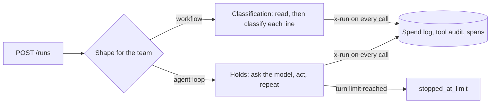
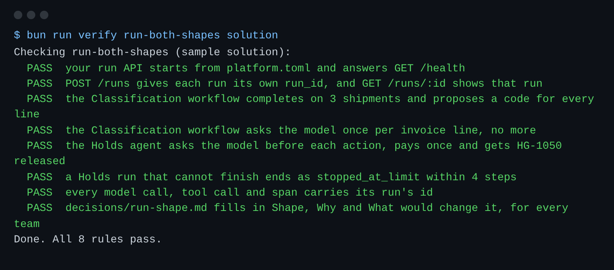

# Run both shapes

## The problem

Each team built its own runner. A runner is the code that starts a run and moves it along.
Holds runs as a fixed list: plan once, then book, pay and check.
When customs refuses the booking, the list goes on anyway.
And no call says which run it belongs to, so nobody can follow one run through the logs.



## Your challenge

Your run API is in `runs.ts`. It already answers `POST /runs` and `GET /runs/:id`.
The runners are in `runners.ts`. The calls to the gateways are in `platform-client.ts`.

1. In `runs.ts`, pick the shape for each team. Classification stays a workflow. Make Holds an agent loop.
2. In `runners.ts`, stop the agent loop after `stepLimit` turns. Return `stopped_at_limit`.
3. In `platform-client.ts`, send the run's id as an `x-run` header on every call.
4. Fill in `decisions/run-shape.md`: the shape for each team, why, and what would change it.

A **workflow** follows a path you write in code.
An **agent loop** asks the model for the next action, each turn.

For example, the check starts a Holds run on HG-1050, which customs holds for an x-ray.
Each turn, the agent loop asks the model with the TASK line `hold:HG-1050`.
The model answers with a plan: `book_exam`, `pay_exam_fee`, `wait_for_release`.
The loop takes the first action that is not done yet.
So the run asks the model 4 times: before each of the 3 actions, and once more to see it is done.

The check also starts a Holds run on HG-1057 with `max_steps: 4`.
HG-1057 has no hold yet, so booking its exam fails every time.
Without a limit, that run never ends.

```bash
bun run verify run-both-shapes
```

Expect: `Done. All 8 rules pass.`



## Done when

- Classification completes on 3 shipments, with one model call per invoice line.
- Holds asks the model before each action, pays once, and HG-1050 is released.
- A Holds run that cannot finish ends as `stopped_at_limit`, within its limit.
- Every row in the spend log, the tool audit and the spans carries its run's id.
- `decisions/run-shape.md` fills in Shape, Why and What would change it, for every team.

## If you get stuck

| What you see                                 | Fix                                                                                          |
| -------------------------------------------- | -------------------------------------------------------------------------------------------- |
| `FAIL ... once per invoice line`             | Send `x-run`. Without it, the check cannot tell which run made a model call.                 |
| `FAIL ... ends as stopped_at_limit`          | Change `while (true)` to a loop that counts turns up to `stepLimit`.                         |
| `FAIL ... asks the model before each action` | Set `holds: "agent"` in `SHAPE_BY_TEAM`.                                                     |
| `FAIL your run API starts ...`               | Run `PORT=4300 TEAMS_FILE=../../../../world/data/teams.json bun runs.ts` and read the error. |

## Words you will use

- **Run**: one piece of work for one team, one importer and one shipment, with its own id.
- **Run shape**: how a run decides its next move. In code (a workflow), or by the model (an agent loop).
- **Step limit**: the most turns an agent loop may take before it stops.
- **`stopped_at_limit`**: the status of a run that used all its turns. It tells a person to look.
