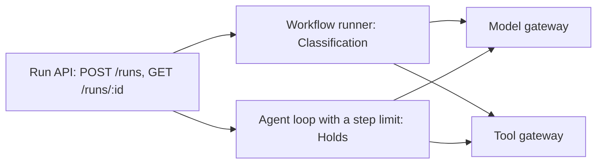

# Choose run shapes

## The problem

Classification follows a fixed path. Holds needs an agent that decides its next step.
Each team built its own runner, the code that starts a run and moves it along.
Nothing is shared: not identity, not budgets, not the record of a run.
For example, a Holds run and a Classification run for the same shipment leave no common record.

## Why it matters

Allianz runs Project Nemo, where several agents handle insurance claims together.
A planner agent leads them, and people handle the claims that will likely be refused ([Allianz](https://www.allianz.com/en/mediacenter/news/articles/251103-when-the-storm-clears-so-should-the-claim-queue.html)).



| Step              | Minutes | What you produce                                                                                          | What its check reads                                                                                                                                                                            |
| ----------------- | ------- | --------------------------------------------------------------------------------------------------------- | ----------------------------------------------------------------------------------------------------------------------------------------------------------------------------------------------- |
| `run-both-shapes` | 20      | A run API that starts either a workflow or an agent loop with a step limit, plus `decisions/run-shape.md` | Both shapes complete on 3 shipments; a loop that hits its limit ends `stopped_at_limit`; every call in a run carries the same `run_id` in the spend log and audit; the decision file's sections |

Before you start, read [Building effective agents](https://www.anthropic.com/engineering/building-effective-agents) by Anthropic.
It names the two shapes this part uses: workflows and agents.

## Walkthrough

Run the check on the sample solution first, so you see what passing looks like.

```bash
bun run verify run-both-shapes solution
```

Expect: `Done. All 8 rules pass.`

Now make the four changes in `problem/`, then check your own work.

```bash
bun run verify run-both-shapes
bun run verify part choose-run-shapes
```

Expect: `Done. All 8 rules pass.`, then `Part choose-run-shapes is done: 1/1 steps pass.`

## Assignment

Each team built its own runner. Hand in a pull request on your fork with:

- your run API, with Holds as an agent loop and a step limit;
- `decisions/run-shape.md`.

It is checked by `bun run verify run-both-shapes`. Each rule passes or fails. There is no partial grade.

Extension: add a third shape, a fan-out run. It classifies many lines at the same time, under one budget.

## Change it

- Set the step limit to 2 and start a Holds run on HG-1050. Which status do you get, and why?
- Make Classification an agent loop. Count the model calls in `bun run spend`. What did the change cost?
- At a startup: one run API with two shapes is often enough for a long time.
- At an enterprise: teams ask for their own runners. The run API is what keeps identity, budgets and records shared.

## Finished

You now have one run API for every team.
Classification runs as a workflow, and Holds runs as an agent loop that cannot spin forever.
Every model call and tool call carries its run's id.

The next part, Survive a crash, makes a Holds run pick up where it stopped after its worker dies.
