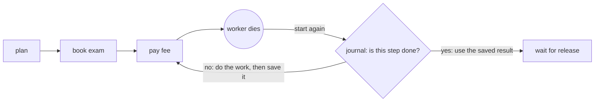
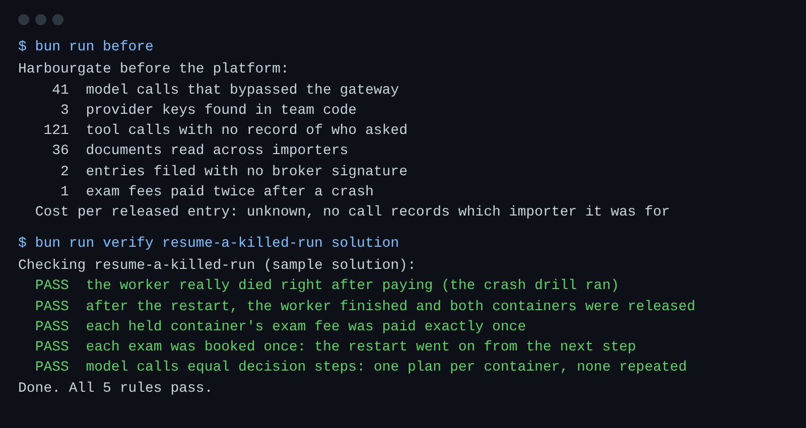

# Resume a killed run

## The problem

The Holds worker paid the x-ray fee for HG-1050. Then it died.
When it started again, it began from the top.
It asked the model for a plan again, booked the exam again, and paid again.
So Ridgeway Roasters paid USD 250 twice.



## Your challenge

`holds.ts` already wraps each step in `step(name, work)`.
But `step()` in `journal.ts` remembers nothing. Make it durable:

1. Open the file named by `JOURNAL_DB` with `bun:sqlite`. Make a table for runs, step names and results.
2. Before the work, look the step up for this `RUN_ID`. If it is there, return the saved result. Do no work.
3. After the work, save the result. Then return it.

Do not change `crash-drill.ts`. It kills the worker once, right after the pay step, like a real crash.

For example, the check puts holds on HG-1050 and HG-1057.
It runs your worker with `CRASH_AFTER=pay_exam_fee`.
The worker plans, books and pays for HG-1050, and then exits with code 137.
The check starts it again with the same `RUN_ID` and the same journal.
The journal already has `plan:HG-1050`, `book_exam:HG-1050` and `pay_exam_fee:HG-1050`.
So the worker goes straight to `wait_for_release:HG-1050`.

```bash
bun run verify resume-a-killed-run
```

Expect: `Done. All 5 rules pass.`



## Done when

- The worker really died right after paying. The check proves the crash happened.
- After the restart, the worker finished and both containers were released.
- Each container's exam fee was paid exactly once.
- Each exam was booked once.
- The model was asked once per container. Model calls equal decision steps.

## If you get stuck

| What you see                                                | Fix                                                                              |
| ----------------------------------------------------------- | -------------------------------------------------------------------------------- |
| `FAIL each held container's exam fee was paid exactly once` | Save the result in the file, not in a variable. A variable dies with the worker. |
| `FAIL model calls equal decision steps`                     | Keep the model call inside `step()`. A saved plan must not be asked for again.   |
| `FAIL the worker really died ...`                           | Keep `crashDrill("pay_exam_fee")` right after the pay step.                      |

## Words you will use

- **Durable step**: a step whose result is saved before the run moves on. It never runs twice for one run.
- **Journal**: the file that holds the saved steps. It lives outside the worker, so it survives a crash.
- **Resume**: start a run again and go on from the first step that is not saved.
- **Decision step**: a step where the model decides something. Here, the plan for one container.
