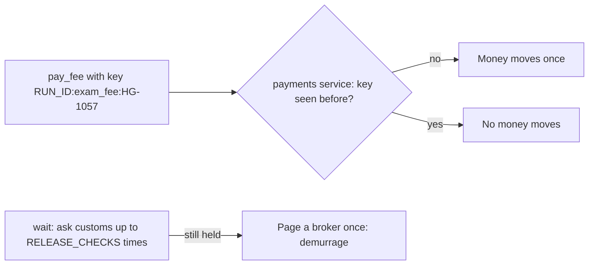

# Release the container once

## The problem

The journal saves a step after its work is done.
But a worker can die after the payment and before the save.
Then the journal says "not paid", and the worker pays again.
And a wait for release that never ends leaves a container at the port, costing demurrage every day.



## Your challenge

Start from your worker from the last step. In `holds.ts`:

1. Build each payment's `idempotency_key` from the run: `RUN_ID`, the purpose and the shipment. Never at random.
2. Make `waitForRelease` ask `check_release` up to `RELEASE_CHECKS` times. Pause `RELEASE_PAUSE_MS` between tries.
3. If the container is still held, page a broker. Send `{ shipment, run_id, reason }` as a POST to `PAGER_URL`. Put "demurrage" in the reason.
4. Make the page a `step()`, so a restart does not page twice.

An **idempotency key** is a name for one payment. The payments service moves money only the first time it sees a key.

For example, the check runs your worker three times with `RUN_ID=holds-replay-drill`.
First a normal run. Customs releases HG-1050, but it never releases HG-1057.
Then a restart with the same journal. Then a replay with the journal deleted.
In the replay, your worker pays for HG-1057 again with the key `holds-replay-drill:exam_fee:HG-1057`.
The payments service has seen that key, so no money moves.

```bash
bun run verify release-the-container-once
```

Expect: `Done. All 6 rules pass.`

## Done when

- The worker finishes every time, even while HG-1057 is never released.
- HG-1050 is released, and each container's fee is paid once.
- A replay with an empty journal tries to pay again, and moves no money.
- Every payment's key names its run.
- HG-1057 was checked 5 times, and a broker was paged once, with a demurrage reason.

## If you get stuck

| What you see                                    | Fix                                                           |
| ----------------------------------------------- | ------------------------------------------------------------- |
| `FAIL a replay of the whole run moves no money` | Replace `crypto.randomUUID()` with a key built from `RUN_ID`. |
| `FAIL the worker finishes every time ...`       | Count the checks. Stop after `RELEASE_CHECKS`.                |
| `FAIL ... a broker got one demurrage page`      | Wrap the page in `step()`, and only page when not released.   |

## Words you will use

- **Idempotency key**: one name for one action. The same key twice means the action happens once.
- **Replay**: running a whole run again from the start, for example after the journal is lost.
- **Free time**: the days a container may wait at the port for free.
- **Demurrage**: what the port charges for each day after free time.
- **Page**: an alert that asks a person to act now.
