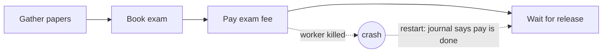

# Survive a crash

## The problem

The Holds worker crashed right after it paid an exam fee.
When it started again, it began from the top and paid a second time.
The container also waited longer at the port.
For example, `bun run before` prints `1  exam fees paid twice after a crash`.

## Why it matters

Instacart runs Maple, a service for large batches of model calls.
It uses Temporal to try failed work again and to recover after a crash ([Instacart](https://company.instacart.com/tech-innovation/simplifying-large-scale-llm-processing-across-instacart-with-maple)).



| Step                         | Minutes | What you produce                                                                                                           | What its check reads                                                                                                                                        |
| ---------------------------- | ------- | -------------------------------------------------------------------------------------------------------------------------- | ----------------------------------------------------------------------------------------------------------------------------------------------------------- |
| `resume-a-killed-run`        | 25      | The Holds run as journaled durable steps                                                                                   | The check kills the worker after `pay_exam_fee` (guard: a worker really died); the payments table shows exactly 1 payment; model calls equal decision steps |
| `release-the-container-once` | 15      | An idempotency key on every money-moving or filing tool, and a durable wait for release with a timeout that pages a broker | Two deliveries of one release event cause 1 release; a run past free time logs a demurrage reason; a replay of the whole run moves no money                 |

Before you start, read [The thread is the Workflow](https://temporal.io/blog/manetu-the-thread-is-the-workflow) on the Temporal blog.
It shows a run that a crashed worker started and another machine finished.

## Walkthrough

See the problem first. The report card counts the fee paid twice by today's Holds script.

```bash
bun run before
```

Expect: a card with the line `1  exam fees paid twice after a crash`.

Then make each step's changes in its `problem/` folder, and check them.

```bash
bun run verify resume-a-killed-run
bun run verify release-the-container-once
bun run verify part survive-a-crash
```

Expect: each step ends `Done.` once your worker is in place, then `Part survive-a-crash is done: 2/2 steps pass.`

## Assignment

The Holds worker paid an exam fee twice after a crash. Hand in a pull request on your fork with:

- the Holds worker with a journal, idempotency keys built from the run, and a wait for release with a limit;
- a recording of 3 minutes or less: the worker dies after paying, starts again, and one payment shows.

It is checked by `bun run verify resume-a-killed-run` and `bun run verify release-the-container-once`.
Each rule passes or fails. There is no partial grade.

Extension: put the journal in a durable engine such as Restate, DBOS or Temporal. Pass the same two checks.

## Change it

- Move `crashDrill("pay_exam_fee")` to just before the pay step. Does the fee get paid once?
- Delete the journal file between two runs with a random key. Count the payments.
- At a startup: a journal table in the database you already have is often enough.
- At an enterprise: a durable engine such as Temporal or Restate does this for every team, with retries and a UI.

## Finished

You now have a Holds run that survives a crash.
Its steps are saved in a journal, its payments carry keys from the run, and a stuck container pages a broker.

The next part, Trace and cost runs, follows one entry through every call and puts a price on it for each importer.
