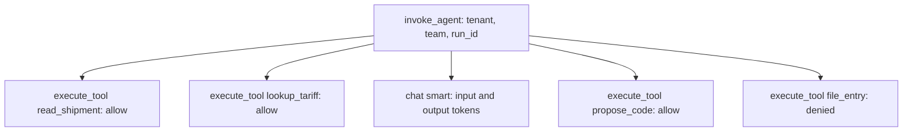
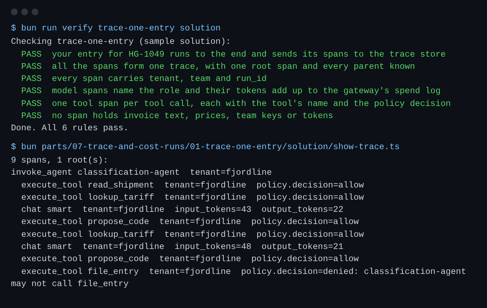

# Trace one entry

## The problem

The Holds team asks why one entry took so long. Finance asks what it cost.
Today each call writes its own log line, and nothing ties the lines together.
You cannot see one entry from start to end, or for which importer it ran.



## Your challenge

`entry.ts` runs one entry for the Classification agent and makes a span for each call.
A **span** is one timed piece of work, such as one model call. A **trace** is all the spans of one run, in a tree.
`tracing.ts` is a small tracing library. You do not need to change it. Change `entry.ts`:

1. Put `tenant`, `team` and `run_id` in the run span's `baggage`. Baggage is copied to every child span.
2. Pass the parent span to `startSpan`, so each span joins the run's trace.
3. On model spans, set `gen_ai.request.model` and the token counts: `gen_ai.usage.input_tokens` and `gen_ai.usage.output_tokens`.
4. On tool spans, set `gen_ai.tool.name` and `policy.decision`. Do not copy the tool's input or output into the span.

For example, the check runs your entry for HG-1049, a rush shipment for Fjordline Outdoor.
The agent reads the shipment and classifies its 2 lines.
Then it tries `file_entry`, and the tool gateway refuses it.
So the trace has 9 spans under one root.
The `file_entry` span says `policy.decision=denied: classification-agent may not call file_entry`.
The `read_shipment` answer holds the invoice text and prices. They must stay out of the trace.

```bash
bun run verify trace-one-entry
bun show-trace.ts
```

Expect: `Done. All 6 rules pass.`, then `9 spans, 1 root(s):` and the tree.



## Done when

- Your entry runs to the end and sends its spans to the trace store.
- All the spans form one trace, with one root span.
- Every span carries `tenant`, `team` and `run_id`.
- Model spans name the role, and their tokens add up to the gateway's spend log.
- There is one tool span per tool call, with the tool's name and the policy decision.
- No span holds invoice text, prices, team keys or tokens.

## If you get stuck

| What you see                          | Fix                                                                         |
| ------------------------------------- | --------------------------------------------------------------------------- |
| `FAIL all the spans form one trace`   | Change `startSpan(name, undefined, ...)` to `startSpan(name, parent, ...)`. |
| `FAIL every span carries tenant ...`  | Set `run.baggage`, not `run.attributes`. Attributes stay on one span.       |
| `FAIL no span holds invoice text ...` | Remove `tool.input` and `tool.output`.                                      |

## Words you will use

- **Span**: one timed piece of work, with a name and attributes.
- **Trace**: every span of one run, linked from child to parent, under one root.
- **Attribute**: a name and a value on a span, such as `gen_ai.tool.name=lookup_tariff`.
- **Baggage**: values a parent passes to every child span, such as the importer.
- **Tenant**: the customer the work is for. Here, the importer.
