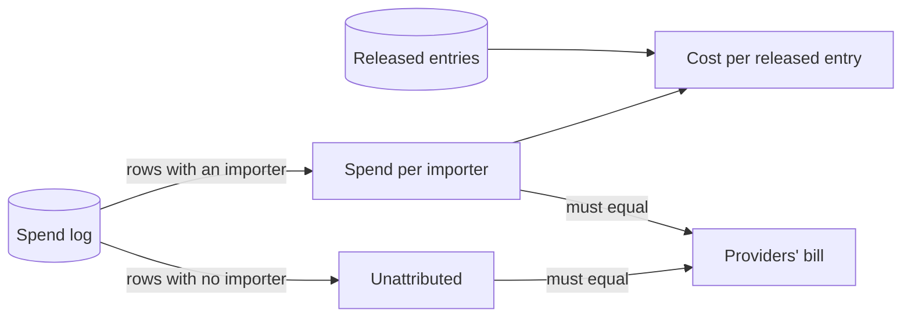
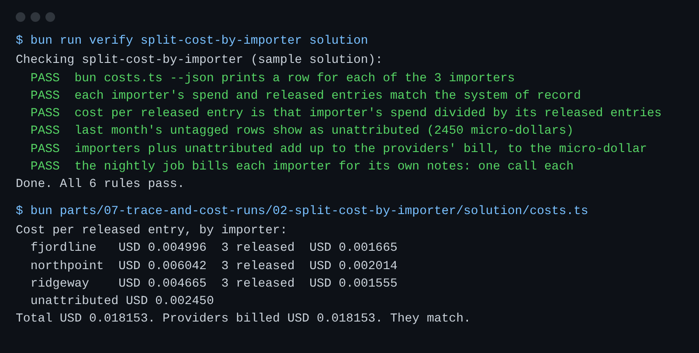

# Split cost by importer

## The problem

Finance asks what Northpoint Medical Supply cost.
The gateway's spend log knows every call, and most rows name an importer.
But last month's nightly job ran before the gateway asked for one, so its rows name nobody.
And tonight's nightly job bills every call to Fjordline, even the calls for Ridgeway and Northpoint.



## Your challenge

1. In `costs.ts`, add the spend rows whose importer is empty. Report them as `unattributed_micros`.
2. Make `total_micros` the importers plus unattributed. It must equal the providers' bill, `billed_micros`.
3. In `nightly.ts`, send each call's `x-importer` as the importer whose notes it refreshes.

`costs.ts` already works out spend and released entries for each importer.
A **released entry** is an entry customs has let through. Cost per released entry is spend divided by those entries.

For example, the check runs the open queue on the finished platform first.
Northpoint ends with 4 released entries.
If Northpoint's calls cost 6,126 micro-dollars, its cost per released entry is 6,126 / 4 = 1,532 (rounded).
The check also adds last month's three untagged rows: 1,200, 800 and 450 micro-dollars.
So `unattributed_micros` must be 2,450.

```bash
bun run verify split-cost-by-importer
bun costs.ts
```

Expect: `Done. All 6 rules pass.`, then a table that ends `They match.`



## Done when

- `bun costs.ts --json` prints a row for each of the 3 importers.
- Each importer's spend and released entries match the system of record.
- Cost per released entry is that importer's spend divided by its released entries.
- Last month's untagged rows show as unattributed: 2,450 micro-dollars.
- Importers plus unattributed add up to the providers' bill, to the micro-dollar.
- The nightly job bills each importer one call, for its own notes.

## If you get stuck

| What you see                                   | Fix                                                          |
| ---------------------------------------------- | ------------------------------------------------------------ |
| `FAIL last month's untagged rows ...`          | Sum `cost_micros` from `spend_log` where `importer IS NULL`. |
| `FAIL importers plus unattributed add up ...`  | Add `unattributed` into `total_micros`.                      |
| `FAIL the nightly job bills each importer ...` | Send `"x-importer": importer`, not one fixed name.           |

## Words you will use

- **Spend log**: the gateway's record of every model call: team, importer, tokens and cost.
- **Unattributed**: money spent that no importer can be billed for. You still show it.
- **Providers' bill**: what the model providers charged. Your report must add up to it.
- **Released entry**: an entry customs has let through. It is the unit finance prices.
