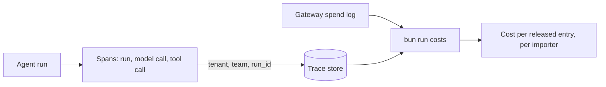

# Trace and cost runs

## The problem

Finance asks what Northpoint cost. The Holds team asks why one entry took so long.
Nobody can answer either question.
No call records the run, the team and the importer together.
For example, `bun run before` prints `Cost per released entry: unknown, no call records which importer it was for`.

## Why it matters

Booking.com runs AgentHub. It gives every team's agent the same tracing, safety rules and tests ([Booking.com](https://booking.ai/introducing-agenthub-booking-com-platform-for-modular-travel-ai-agents-68bc521a0f50)).



| Step                     | Minutes | What you produce                                                                                     | What its check reads                                                                                                                                                          |
| ------------------------ | ------- | ---------------------------------------------------------------------------------------------------- | ----------------------------------------------------------------------------------------------------------------------------------------------------------------------------- |
| `trace-one-entry`        | 20      | Spans for runs, model calls and tool calls with GenAI attributes, with `tenant`, `team` and `run_id` | The trace store for one entry: one trace, `tenant` on every span, token counts on model spans, the policy decision on tool spans, no field from `checks/sensitive-fields.txt` |
| `split-cost-by-importer` | 15      | `bun run costs`: cost per released entry per importer, joining traces to spend rows                  | Cost by importer sums to the providers' bill; 0 spend rows without a tenant; a planted untagged batch job shows as unattributed, then disappears                              |

Before you start, read the [OpenTelemetry semantic conventions for generative AI](https://github.com/open-telemetry/semantic-conventions-genai).
They name the span attributes this part uses, such as `gen_ai.usage.input_tokens`.

## Walkthrough

See the problem first. Today's report card cannot price an entry.

```bash
bun run before
```

Expect: the card ends `Cost per released entry: unknown, no call records which importer it was for`.

Then make each step's changes in its `problem/` folder, and check them.

```bash
bun run verify trace-one-entry
bun run verify split-cost-by-importer
bun run verify part trace-and-cost-runs
```

Expect: each step ends `Done.` once your work is in place, then `Part trace-and-cost-runs is done: 2/2 steps pass.`

## Assignment

Finance cannot say what Northpoint cost. Hand in a pull request on your fork with:

- spans with GenAI attributes and `tenant`, `team` and `run_id` as baggage;
- `costs.ts`, whose numbers add up to the providers' bill, and the fixed nightly job.

It is checked by `bun run verify trace-one-entry` and `bun run verify split-cost-by-importer`.
Each rule passes or fails. There is no partial grade.

Extension: send the same spans to Langfuse as a second trace store. Show that both agree on cost.

## Change it

- Put the invoice body on the `read_shipment` span. Which rule fails, and who could read it there?
- Charge the unattributed spend to the importers by their share of calls. Is that fair to Ridgeway?
- At a startup: one trace store and one cost query are often enough.
- At an enterprise: finance wants these numbers in its own system, every month, with the same total as the bill.

## Finished

You now see every entry as one trace, with its importer, team and run on every span.
You can price a released entry for each importer, and your total matches the providers' bill.

The next part, Gate each release, uses these runs to block a prompt change that sends gloves to the wrong code.
