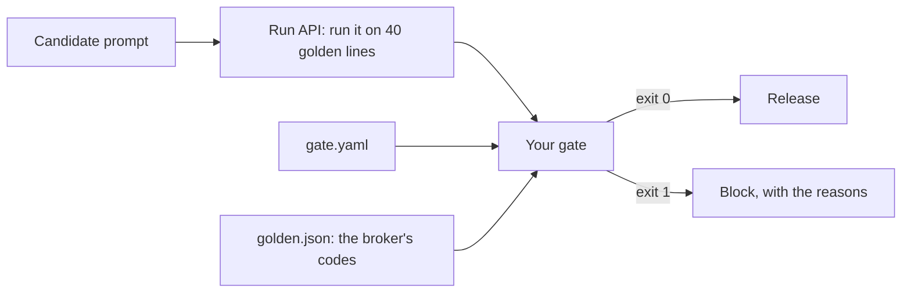
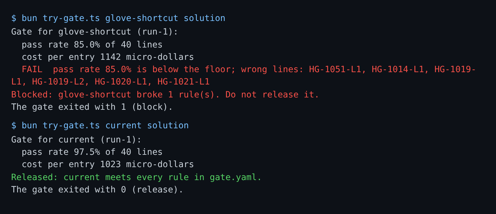

# Block a bad release

## The problem

Someone changed the Classification prompt.
It looked better on five examples, so it went out.
Then it gave every Northpoint glove line the non-medical code `ST-4015-19`.
The right code is `ST-4015-12`, gloves for medical use.
Nothing checked the change before it reached the brokers.



## Your challenge

A **release gate** is a program that runs before every release and says yes or no.
Your gate has two kinds of rule:

- **Never-do rules** with zero tolerance: unsigned filings, cross-importer reads, double payments.
  One is too many, however good the codes are.
- **A pass-rate floor** below 100%: the share of the 40 lines in `../golden.json` the candidate must get right.
  The broker still reviews every code, so a few misses are fine.
  A gate that demands perfection blocks every release.

There is also a cost ceiling. A better prompt that costs three times as much is not released by accident.

Open `gate.yaml` and fill in the values. Then finish the two TODO functions in `gate.ts`.
The gate gets `CANDIDATE`, `RUNS_URL` and `GOLDEN_FILE`.
It asks the run API with `POST /runs`, then reads `GET /runs/<run_id>`.
It reads every number from there, never from the `candidates/` folder.

For example, today's prompt gets 39 of 40 lines right at about 1023 micro-dollars per entry.
Try the planted glove prompt on the sample answer:

```bash
bun parts/08-gate-each-release/01-block-a-bad-release/try-gate.ts glove-shortcut solution
```

Expect: `FAIL  pass rate 85.0% is below the floor; wrong lines: HG-1051-L1, ...`, then `Blocked:` and `The gate exited with 1 (block).`

Your gate also writes `out/gate.json` with these fields: `candidate`, `run_id`, `decision` (`release` or `block`), `reasons`, `pass_rate` (0 to 1), `pass_rate_floor`, `lines_total`, `failing_lines`, `never_do`, `cost_per_entry_micros` and `cost_ceiling_micros`.

```bash
bun run verify block-a-bad-release
```

Expect: `Done. All 10 rules pass.`



## Done when

- Today's prompt is released (exit 0), and the glove prompt is blocked (exit 1) with its wrong lines named.
- A candidate with one unsigned filing is blocked, even with every line right.
- A candidate above the cost ceiling is blocked.
- Candidates the gate has never seen are judged through the run API alone.
- When the run API is down, the gate blocks.

## If you get stuck

| What you see                               | Fix                                                                     |
| ------------------------------------------ | ----------------------------------------------------------------------- |
| `FAIL  today's prompt is released ...`     | Your floor is too high. 39 of 40 is 0.975.                              |
| `FAIL  ... one unsigned filing is blocked` | Compare every `never_do` count from the run with `gate.yaml`.           |
| `FAIL  ... never seen are judged ...`      | Read the run from `RUNS_URL`. Do not look up the candidate's name.      |
| `FAIL  with the run API down ...`          | Catch the error, print why, and exit 2. Never exit 0 on an error.       |
| `409 ... the prompt ... changed`           | You edited a prompt in `candidates/`. Undo it: replay has no recording. |

## Words you will use

- **Golden set**: lines a licensed broker already classified and signed. The gate grades against them.
- **Candidate**: a change you want to release, here a new prompt.
- **Pass rate**: the share of golden lines the candidate got right.
- **Fail closed**: when the gate cannot judge, it blocks.
