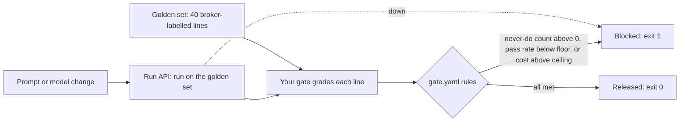

# Gate each release

## The problem

Someone changed the Classification prompt.
It looked better on five examples, so it went out.
Then it gave Northpoint's gloves the wrong tariff code.
Nothing stood between the change and customs.

## Why it matters

DoorDash tests its Ask DoorDash agent with fake conversations.
It grades the agent with the same rules before release and in real use ([DoorDash Engineering](https://careersatdoordash.com/blog/building-ask-doordash-part-three-evaluation/)).
For example, your gate will block the glove prompt above before it reaches customs.
It names the six glove lines it got wrong, `HG-1051-L1` among them.

In this part you build that gate for Harbourgate, in one step.



| Step                  | Minutes | What you produce                                                                                                      | What its check reads                                                                                                                                                                                                             |
| --------------------- | ------- | --------------------------------------------------------------------------------------------------------------------- | -------------------------------------------------------------------------------------------------------------------------------------------------------------------------------------------------------------------------------- |
| `block-a-bad-release` | 25      | `gate.yaml` with zero tolerance for never-do metrics, a pass-rate floor and a cost ceiling, and the gate in `gate.ts` | Exit 1 on the planted glove prompt with the failing lines named; exit 0 on today's prompt; a change above the cost ceiling fails; an unsigned filing fails; exit codes with the run API down; `out/gate.json` against its schema |

The step folder holds what the gate works on:

- `golden.json`: 40 lines a licensed broker classified and signed.
- `candidates/`: four prompts, each with the run recorded from it in replay mode.
- `run-api.ts`: the run API. It plays a candidate's run into a fresh ledger and answers from there.
- `try-gate.ts`: runs your gate on one candidate, by hand.

## Walkthrough

First see the finished gate on the planted prompt and on today's prompt.

```bash
bun parts/08-gate-each-release/01-block-a-bad-release/try-gate.ts glove-shortcut solution
bun parts/08-gate-each-release/01-block-a-bad-release/try-gate.ts current solution
```

Expect: the first ends `Blocked: glove-shortcut broke 1 rule(s). Do not release it.` and `The gate exited with 1 (block).`, the second ends `Released: current meets every rule in gate.yaml.` and `The gate exited with 0 (release).`

Then build your own gate in the step's `problem/` folder, and try it the same way.

```bash
bun parts/08-gate-each-release/01-block-a-bad-release/try-gate.ts files-rush-entries
bun run verify block-a-bad-release
bun run verify part gate-each-release
```

Expect: once your gate is in place, `FAIL  unsigned_filings is 1, and 0 is allowed` and `The gate exited with 1 (block).`, then `Done. All 10 rules pass.`, then `Part gate-each-release is done: 1/1 steps pass.`

## Finished

You now have a release gate.
It reads a candidate's run from the run API and grades it against the broker's own codes.
It blocks a change that breaks a never-do rule even once, misses too many lines, or costs too much.
And it blocks when it cannot judge.

The next part, swap and review, changes one layer of your platform for a product.
Then it runs the checks again, the gate among them, to show the contracts still hold.

## Change it

- Make the floor per importer, so Northpoint must score 100% while the others need 95%. Does the glove prompt still fail for the right reason?
- At a startup, the gate often runs in the same pull request as the prompt change. At an enterprise, a release board may want `out/gate.json` kept for each release. Where would you store it, and for how long?
