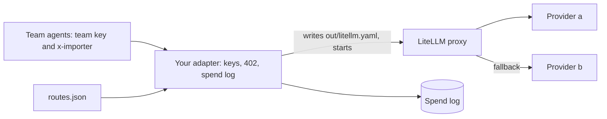

# Swap one layer

## The problem

The review board asks: "What happens if we buy a product for one of these layers?"
A good platform answers: "The teams change nothing, and the checks still pass."
Today nobody has tried it, so nobody knows.



## Your challenge

Swap the model gateway's provider calls for **LiteLLM**, an open-source model proxy.
An **adapter** is the small piece of code that lets the teams keep the same contract while a product does the work.

Your adapter is `litellm-gateway.ts`.
It already writes LiteLLM's config from `routes.json` and starts LiteLLM.
The keys, the budgets and the spend log stay in the adapter, because LiteLLM does not know Harbourgate's teams.

1. Finish the three TODO functions: `askLiteLLM`, `failedTries` and `whoAnswered`.
   LiteLLM answers with two headers you need.
   For example, with provider a down, a call for `fast` comes back with `x-litellm-model-group: b-fast` and `x-litellm-attempted-fallbacks: 1`.
   So you log one `provider_error` row for `a:fast`, and answer with `x-gateway-provider: b`.
2. In `platform.toml`, start the adapter and add `[swap]`:

   ```toml
   [gateway]
   start = "bun litellm-gateway.ts"

   [swap]
   layer = "model-gateway"
   product = "LiteLLM proxy"
   product_start = "bun ../litellm-stand-in.ts --config out/litellm.yaml --port $PRODUCT_PORT"
   ```

   CI has no Python, so `litellm-stand-in.ts` plays LiteLLM. It reads the same config and speaks the same API.
   With Python, you can set `product_start` to the real `litellm` command shown in the sample `platform.toml`.
   Check LiteLLM's security advisories before you install it.
3. Write `decisions/swap.md`: what you swapped, what stays the same, what you gained, what you lost, and how you would undo it.

Do not change anything under `teams/`.

```bash
bun run verify swap-one-layer
```

Expect: `Done. All 7 rules pass.`

## Done when

- `platform.toml` names the layer and the product under `[swap]`.
- Every model gateway check passes again on the swapped gateway.
- The three team agents run the open queue on it with a clean report card.
- Nothing under `teams/` changed.
- `decisions/swap.md` fills every section and names at least one thing you lost.

## If you get stuck

| What you see                                  | Fix                                                                |
| --------------------------------------------- | ------------------------------------------------------------------ |
| `LiteLLM did not start`                       | Run the `product_start` command by hand, with `PRODUCT_PORT=4001`. |
| `FAIL  every check of the swapped layer ...`  | Keep 401, 402 and one spend row per call in the adapter.           |
| `FAIL  the team agents ... clean report card` | Send LiteLLM your master key, never the team's key.                |
| `FAIL  ... names at least one thing you lost` | "Nothing" is never true. What can you no longer see or change?     |

## Words you will use

- **Adapter**: code that keeps your contract while a product does the work behind it.
- **Model group**: LiteLLM's name for a model the caller asks for. Here `b-fast` means provider b, fast role.
- **Fallback**: trying the next provider when the first one fails.
