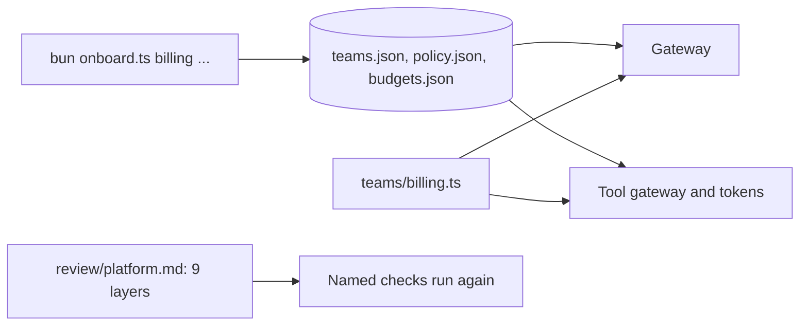
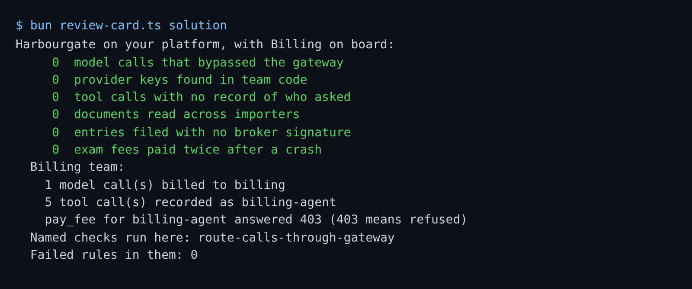

# Pass the platform review

## The problem

The review board has two questions.
First: "Which product would fill each layer if we bought one, and what would it miss?"
Second: "A fourth team, Billing, wants to start next. How long until it can?"
A good platform answers the second one with: "One command, and no code change."



## Your challenge

1. **Finish `onboard.ts`.** It already adds the team with a new key.
   Make it also give `<team>-agent` its tools in the policy, and the team its budget.
   It changes data files only. The platform reads them when it starts.

```bash
cd parts/09-swap-and-review/02-pass-the-platform-review/problem
bun onboard.ts billing list_open_shipments,read_shipment,email_importer 500000
git diff --stat .
```

Expect: `Team billing is onboarded. Agent: billing-agent. ...`, then only `budgets.json`, `policy.json` and `teams.json` in the diff.

2. **Fill `review/platform.md`.** One row per layer.
   For example, the `model-gateway` row says the contract is `POST /v1/chat/completions` with a team key and `x-importer`.
   Its check is `route-calls-through-gateway`, and AWS Bedrock AgentCore fills it with Bedrock model access.
   In Gap, write what the product does not do for Harbourgate.
   Vendors rename products often. Check each name on the vendor's own page.

Then see the final report card, with Billing on board:

```bash
bun ../review-card.ts
bun run verify pass-the-platform-review
```

Expect: six lines of `0`, Billing's model and tool calls, `pay_fee for billing-agent answered 403`, then `Done. All 8 rules pass.`



## Done when

- `review/platform.md` has nine rows, every cell filled, and each row names a check of its layer.
- The named checks that run on this folder pass.
- Billing is onboarded once, with its own new key, its tools and its budget, and no code changed.
- The Billing agent works, and is refused a tool it was not given.
- The report card is still all zeros.

## If you get stuck

| What you see                             | Fix                                                                      |
| ---------------------------------------- | ------------------------------------------------------------------------ |
| `FAIL  onboarding adds Billing once ...` | Set the policy and the budget. Running twice must not add two teams.     |
| `FAIL  the Billing agent works ...`      | Give `billing-agent` the three tools, and never another team's key.      |
| `FAIL  every row names a check ...`      | Use a step name from that layer's part, such as `isolate-importer-data`. |
| `FAIL  onboarding changed data only ...` | Write the three JSON files only, never a `.ts` file.                     |

## Words you will use

- **Onboarding**: adding a new team so its agent can use the platform.
- **Contract**: what a layer promises to every team, written so a check can test it.
- **Gap**: what a product leaves for you to build or prove.
