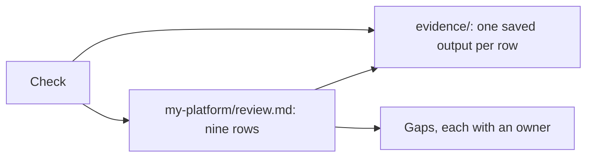

# Review your own platform

## The problem

You have built a platform for the course. Now a board asks about yours.
For example, your own team's agent may have a model key in code, no tool list, and no record of who ran what.
A review is useful only when each claim has a saved output next to it.



## Your challenge

Work in `my-platform/` on your own project, at work or at home. It does not use the course world.

1. Fill the top of `review.md`: your project's name, your name as owner, and the date.
2. For each of the nine layers, fill one row. Say what your project uses, what it promises, and a command that tests it.
3. Run each command. Save its output in `evidence/`. The first line is `Command:` and the second is `Date:`. Use a different file for each layer.
4. If a layer has nothing yet, write `none` in Evidence. In the last cell, write what is missing and an owner, like `no spend cap; owner: Dana`.
5. Find at least three gaps, each with an owner.

```bash
bun run verify review-your-own-platform
```

Expect: `Done. All 8 rules pass.`

## Done when

- The review has a project name, an owner and a date.
- There is one filled row for each of the nine layers.
- At least six layers have an evidence file that exists, with its command and date.
- A layer with no evidence says what is missing and who owns the fix.
- At least three gaps have an owner, and nothing is copied from the course.

## If you get stuck

| What you see                         | Fix                                                                |
| ------------------------------------ | ------------------------------------------------------------------ |
| `FAIL ... an evidence file that ...` | Name a file that exists, and start it with `Command:` and `Date:`. |
| `FAIL no two layers share ...`       | Run a separate command for each layer and save each output.        |
| `FAIL ... who owns the fix`          | Write `owner:` and a name in the gap cell.                         |
| `FAIL ... not the course world`      | Remove course names and describe your own project.                 |

## Words you will use

- **Evidence**: a saved output that proves a claim, with the command and the date.
- **Gap**: something your platform does not do yet.
- **Owner**: the person who will fix a gap.
