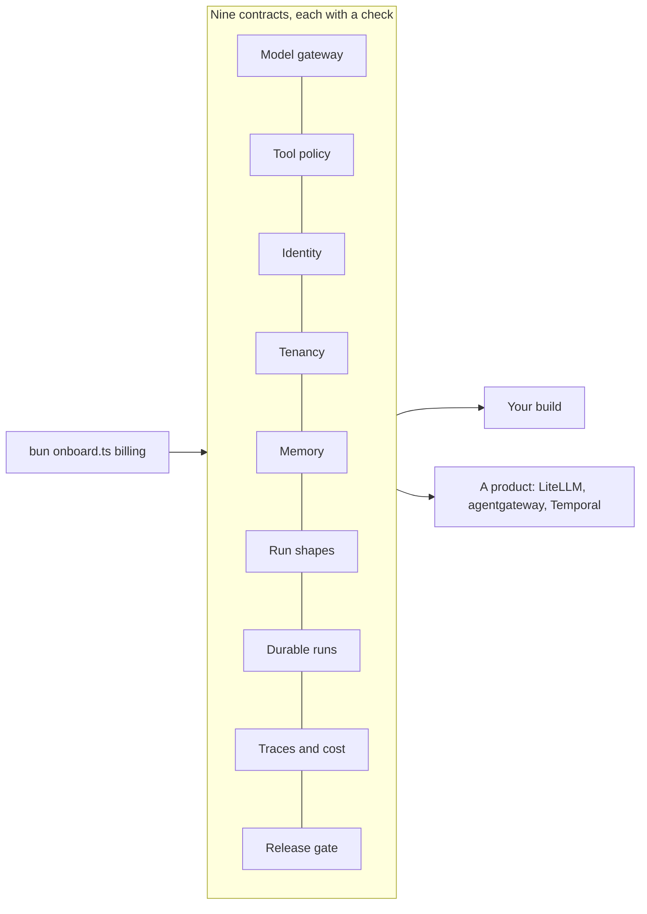

# Swap and review

## The problem

The review board asks: what if Harbourgate moves to an agent platform it buys?
The answer must be "the checks still pass".
An architect must also show which product fills each layer, and what it misses.
And the next team, Billing, wants to start soon.
For example, you will swap your model gateway's provider calls for LiteLLM.
Then you run the model gateway checks again, and they still pass.

## Why it matters

Grab shows the shared framework and gateway its teams build agents on ([Grab Engineering](https://engineering.grab.com/how-grab-builds-and-runs-ai-agents-at-scale)).
A shared platform pays off when a new team can join it without new platform code.



| Step                       | Minutes | What you produce                                                                                                                    | What its check reads                                                                                                                                                                     |
| -------------------------- | ------- | ----------------------------------------------------------------------------------------------------------------------------------- | ---------------------------------------------------------------------------------------------------------------------------------------------------------------------------------------- |
| `swap-one-layer`           | 25      | The model gateway's provider calls swapped onto LiteLLM through an adapter, `[swap]` in `platform.toml`, and `decisions/swap.md`    | Every check of the swapped layer on the swapped platform; the three team agents on it with a clean report card; no change under `teams/`; the decision file's sections                   |
| `pass-the-platform-review` | 20      | `review/platform.md`, one row per layer with its contract, its check and three managed products, and `onboard.ts` for a fourth team | Nine rows naming checks of their layer; those checks run again; Billing onboarded with a new key, its tools and budget and no code change; Billing's calls; the report card is all zeros |

## Walkthrough

First see the sample swap pass the model gateway checks, and the sample review's report card.

```bash
bun run verify swap-one-layer solution
bun parts/09-swap-and-review/02-pass-the-platform-review/review-card.ts solution
```

Expect: `Done. All 7 rules pass.`, then six lines of `0`, `1 model call(s) billed to billing` and `pay_fee for billing-agent answered 403 (403 means refused)`.

Then do each step in its `problem/` folder.

```bash
bun run verify swap-one-layer
bun run verify pass-the-platform-review
bun run verify part swap-and-review
```

Expect: once your work is in place, each step ends `Done.`, then `Part swap-and-review is done: 2/2 steps pass.`

## Finished

You now have a platform the review board can trust.
One layer runs on a product, and the same checks prove it still keeps its contract.
A table maps every layer to its contract, its check and three managed products, with the gaps.
And a new team joins with one command and no platform code.

This is the end of the course.
Your project is this platform: a repo where `bun run verify --all` passes, `decisions/swap.md` and `review/platform.md`.

## Change it

- Swap a second layer once its part is in your repo, such as the tool gateway onto agentgateway. Do the same checks still pass?
- At a startup, the review is a short note in the repo. At an enterprise, an architecture board may ask for the gaps as risks with owners. Who owns the tenancy gap at your company?
