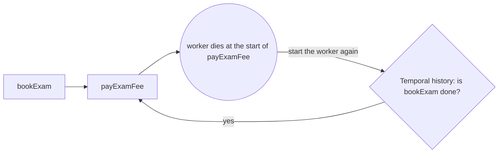

# Run the resume on Temporal

## The problem

Your journal file does the job, but you own it. A team that runs Temporal gets the same resume from the engine.
For example, the Holds worker books an exam and dies before it pays. When it starts again, it must pay once and never book again.
Move that resume layer onto Temporal without touching the other six layers.



## Your challenge

The starter has `worker.ts` and `start.ts` done for you, and two stubs to fill in.

1. In `activities.ts`, make `bookExam` and `payExamFee` call the tools `book_exam` and `pay_fee` with `callTool`, as `holds.ts` does in the survive-a-crash part. Use one idempotency key per shipment.
2. In `workflow.ts`, make `clearHold` call `bookExam`, then `payExamFee`.
3. Keep `crashDrill("pay_exam_fee")` at the top of `payExamFee`. Do not change `crash-drill.ts`.

Start the dev server, then check your work. The check kills the worker after the booking, starts it again, and reads the workflow history.

```bash
docker compose -f assignment/compose.yml up -d --wait
bun run verify run-the-resume-on-temporal
```

Expect: `Done. All 6 rules pass.` In the web page at `http://localhost:8233`, the workflow shows `Completed`.

## Done when

- `@temporalio/client` resolves to 1.25.0.
- The worker really died after the booking.
- The workflow reaches Completed after the worker was killed and started again.
- Each activity has exactly one completed event in the history.
- The exam was booked once and the fee was paid once.
- The course's existing checks still pass.

## If you get stuck

| What you see                              | Fix                                                                       |
| ----------------------------------------- | ------------------------------------------------------------------------- |
| `FAIL the worker really died ...`         | Keep `crashDrill("pay_exam_fee")` at the top of `payExamFee`.             |
| `FAIL ... exactly one completed event`    | Make each step its own activity. Do not join the booking and the payment. |
| `docker compose could not start Temporal` | Start Docker Desktop, then run the compose command again.                 |

## Words you will use

- **Workflow**: the code that says which steps run, and in what order. Temporal saves its progress.
- **Activity**: one step that does real work and may fail. Temporal runs it again if the worker dies.
- **History**: the list of events Temporal saves for a workflow. A restarted worker reads it to go on.
- **Worker**: the process that polls Temporal and runs your activities.
