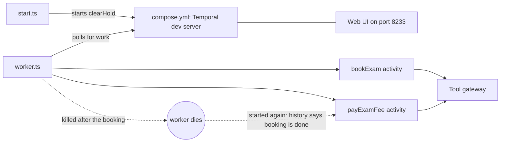

# Make the resume survive a crash with Temporal

## The problem

You built the resume layer by hand. A journal file remembers each finished step.
When the Holds worker dies and starts again, it skips the steps already done.
Most teams do not keep a journal file of their own. They run a durable workflow engine.
For example, Instacart runs its batch model calls on Temporal.

## Why it matters

A hand-built journal teaches how resume works. A product gives you the same resume plus retries, timeouts and a screen that shows every run.
Use the part to see that the idea you built is the one the product sells.

## What we teach

You redo the resume layer with [Temporal](https://temporal.io), an open-source durable workflow engine (MIT licence).
Each step of the Holds run becomes one activity, which is Temporal's word for a step that can fail and try again.
Temporal writes a history of every finished activity, so a restarted worker goes on from the next one.
Nothing in parts 00 to 09 changes. This part is optional in the live session and expected as homework.



| Step                         | Minutes | What you produce                                                                            | What its check reads                                                                                                    |
| ---------------------------- | ------- | ------------------------------------------------------------------------------------------- | ----------------------------------------------------------------------------------------------------------------------- |
| `run-the-resume-on-temporal` | 25      | `workflow.ts`, `activities.ts` and `worker.ts`: the Holds run as two activities on Temporal | The workflow history through `@temporalio/client` 1.25.0: Completed, and one completed event per activity, after a kill |

## Walkthrough

First see the sample solution pass. The check starts the Temporal dev server from `assignment/compose.yml`, kills the worker after the booking, starts it again, and reads the history.

```bash
bun run verify run-the-resume-on-temporal solution
```

Expect: `Done. All 6 rules pass.` The check stops the server it started.

Now start the server yourself, so you can watch the run in the web page.

```bash
docker compose -f assignment/compose.yml up -d --wait
```

Expect: the container `agentic-architecture-assignment-temporal-1` shows `Healthy`, and `http://localhost:8233` opens the Temporal web page.

Then work in the step's `problem/` folder and check it.

```bash
bun run verify run-the-resume-on-temporal
bun run assignment
```

Expect: `Done. All 6 rules pass.`, then `assignment/result.json` lists each line as `pass`. In the web page, the workflow shows `Completed` and `bookExam` ran once.

Last, stop and remove the server.

```bash
docker compose -f assignment/compose.yml down -v
```

Expect: the container and its network are removed. The dev server keeps its data in memory, so nothing stays on disk.

## Options

**DBOS** is the runner-up. It makes steps durable inside the Postgres you already run.

- **Choose when**: you want durable steps inside an existing Postgres with no extra server to run.
- **Trade-off**: fewer teams list it, and the workflow lives in your app process, so a crash of the app is a crash of the engine.

## Assignment

The same task as the step, for homework. The full text is in [assignment/README.md](../../assignment/README.md).
Push a branch named `assignment` and submit its URL. The grader runs `bun run assignment` again.

## Finished

The resume layer now runs on the tool teams run. The other six layers did not change.
The part leaves you with a rule to take away: keep the hand-built version to learn from, and use the product to run.

## Change it

- Add a third activity, `waitForRelease`, and kill the worker before it. Does its history still show one completed event?
- Change the timeout in `workflow.ts` to 1 second. What happens to a slow tool call?
