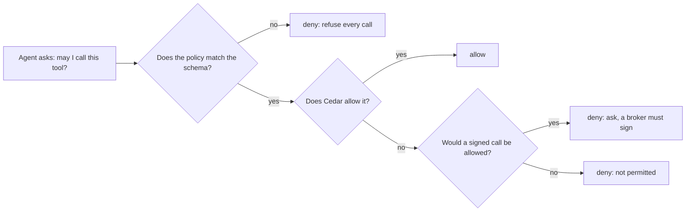

# Decide tool calls with Cedar

## The problem

In the last part, the rules lived in `policy.yaml`. Nothing checked them.
A rule could name a tool that does not exist, and the engine would never notice.
A wildcard `"*"` could also let every agent call every tool.

The Classification agent must never file an entry. Its rules must say so, and the engine must enforce them.



## Your challenge

`policy.ts` asks Cedar one question for each call. Cedar reads the rules in `policy.cedar`.

1. Write one `permit` for each tool that a team may use. Read `world/data/teams.json`. Permit nothing else.
   For example, this line lets the Holds agent pay the exam fee:
   `permit (principal == Agent::"holds-agent", action == Action::"pay_fee", resource);`
2. Give the Paperwork agent `file_entry`, but only when the call has a broker's signature.
   For example, add `when { context.brokerSigned };` after the permit.
3. In `policy.ts`, import `validate`, and set `schemaProblem` from the first error it reports.
   When the policy does not match `schema.cedarschema`, the engine refuses every call.

Check your work:

```bash
bun run verify write-the-policy-in-cedar
```

Expect: four lines that start with PASS or FAIL, then `Done. All 4 rules pass.` once your work is complete.

## Done when

- Each agent may call only its own tools. The check asks about all 36 pairs.
- The planted `file_entry` call from the Classification agent is refused with 403, and the reason names the agent.
- A policy that does not match the schema refuses all 36 calls.
- The policy engine and the tool gateway start from `platform.toml`.

## If you get stuck

| What you see                                                 | Fix                                                                                             |
| ------------------------------------------------------------ | ----------------------------------------------------------------------------------------------- |
| `FAIL all 36 cells of the policy table match the decision`   | Compare each agent with `world/data/teams.json`. Remove any tool that the team may not use.     |
| `FAIL the planted call ... is refused with 403`              | Remove any permit for `file_entry` that names `classification-agent`.                           |
| `FAIL a policy that fails the schema refuses every call ...` | Call `validate()` with the schema and the policy. Set `schemaProblem` when it reports an error. |
| A tool name is wrong in `policy.cedar`                       | Copy the name from `schema.cedarschema`. Action names match the tool names exactly.             |

## Words you will use

- **Principal**: who asks. Here it is the agent, such as `Agent::"paperwork-agent"`.
- **Action**: what the caller wants to do. Here it is the tool, such as `Action::"file_entry"`.
- **Permit**: a rule that allows a call. Cedar denies every call that no permit allows.
- **Schema**: the list of agents, tools and fields that a policy may use. Here it is `schema.cedarschema`.
- **Validate**: check a policy against the schema before you use it.
- **Fail closed**: when the engine cannot decide, refuse the call.
