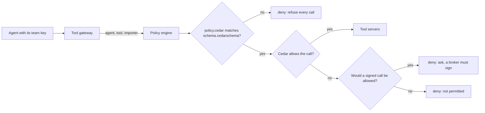

# Decide tool calls with Cedar

## The problem

The rules in `policy.yaml` are plain text, and nothing checks them.
A rule can name a tool that does not exist, and the engine would never notice.
A wildcard `"*"` can also let every agent call every tool.

We need a policy language that a reviewer can read.
A tool must be able to check it against a schema.
It must refuse any call that the rules do not name.

## Why it matters

A rule that a reviewer can read is a rule a team can check.
A schema check catches a wrong tool name before the engine decides anything.
Deny by default means a new tool stays closed until someone writes a permit for it.

For example, the Classification agent asks to call `file_entry`.
No permit names that pair, so the engine refuses the call and the reason names the agent.

## What we teach

- A policy has three parts: a principal (the agent), an action (the tool) and a resource (the importer).
- A `permit` allows one pair. Every call that no permit allows is denied.
- Cedar has no "ask" state. The engine adds it: a call without a broker's signature is refused
  with the reason "ask". The same call with `brokerSigned: true` is allowed.
- The schema lists every agent, tool and field. A policy that uses a name the schema does not know is refused.



| Step                        | Minutes | What you produce                                                                    | What its check reads                                                                            |
| --------------------------- | ------- | ----------------------------------------------------------------------------------- | ----------------------------------------------------------------------------------------------- |
| `write-the-policy-in-cedar` | 20      | `policy.cedar` with one permit per team tool; `policy.ts` that validates the policy | All 36 cells of the policy table; the planted `file_entry` call; a policy that fails the schema |

## Walkthrough

Go to the repo root. Run the check on the sample answer first, so you can see what a pass looks like:

```bash
bun run verify write-the-policy-in-cedar solution
```

Expect: four PASS lines, then `Done. All 4 rules pass.`

Now check the starter in the problem folder. It lets every agent call every tool, so the check fails:

```bash
bun run verify write-the-policy-in-cedar
```

Expect: two PASS lines, two FAIL lines with a `Try next:` line under each, then `2 of 4 rules pass. Fix the FAIL lines and run it again.`

After you finish the step, check the whole part:

```bash
bun run verify part decide-tool-calls-with-cedar
```

Expect: `Part decide-tool-calls-with-cedar is done: 1/1 steps pass.`

## Finished

The engine asks Cedar each call, and Cedar answers from the policy file.
A permit names one agent and one tool. A call that no permit names is refused.
A policy that does not match the schema stops every call, so a typo cannot open a door.

## Assignment

- **Hand in**: a pull request with your `policy.cedar` and your `policy.ts`.
- **Rubric** (each line is yes or no; all must be yes):
  - Each team's agents hold only their own tools, and the policy passes schema validation.
  - The planted filing is denied with a reason, and a signed filing is allowed.
  - A broken policy file refuses every call.

## Options

### Choose Cedar when

Choose Cedar when you need rules that a reviewer can read and a schema check before the engine starts.
Choose it also when the decision must run inside the same process, in well under a millisecond.

### Trade-off

Cedar has no "ask" state, and it has no relationships between users and objects.
This part adds the ask in the engine. It does not model who owns what.

### Runner-up: OpenFGA

Choose OpenFGA when access follows who owns what, such as a user who owns a shipment.
OpenFGA is relationship based, and you accept running a server for it.
Open Policy Agent is another option. This part does not use it.
